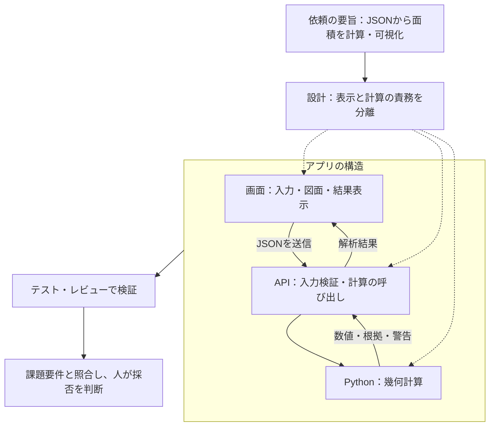

# 平面図 面積・壁面積 解析アプリ

> この `main` ブランチには説明資料を掲載しています。アプリ本体は [feature/kimura](https://github.com/Kimurist2024/KKG-kadai/tree/feature/kimura) を参照してください。以下の起動手順は同ブランチをチェックアウトし、`floorplan-analyzer/` を作業ディレクトリとして実行します（`.claude/scripts/` のコマンドはリポジトリ直下で実行）。

公開サイト: https://floorplan-analyzer-taupe.vercel.app （JSON 解析を確認済み、画像 AI は未設定）

**部屋・壁・ドアマスク JSON** から、部屋ごとの **床面積・周長・壁面積** を算出する Web アプリです。
提出用の画面は JSON アップロードと固定条件での解析に絞っています。画像 AI の入力欄は表示しません。

- フロントエンド: TypeScript / React / Next.js App Router（`frontend/`）
- バックエンド: Python / FastAPI（`backend/`）
- AI: FastAPI → OpenAI Responses API（画像入力・Structured Outputs）。キー未設定でも JSON 解析は利用できます。
- 配置: Docker Compose、AWS ECS Fargate 用 Terraform、GitHub Actions（テスト・ビルド・手動デプロイ）。
- ブラウザ → Next.js の API プロキシ → FastAPI と HTTP で連携します。

部屋選択時の表示処理の改善と計測結果は [性能検証](https://github.com/Kimurist2024/KKG-kadai/blob/feature/kimura/floorplan-analyzer/docs/selection-performance.md) を参照してください。
面積・壁・扉の計算高速化と変更前後の全項目比較は [アルゴリズム性能検証](https://github.com/Kimurist2024/KKG-kadai/blob/feature/kimura/floorplan-analyzer/docs/validation/algorithm-performance/report.md) を参照してください。
直前の実装を基準にした最新の高速化・浮動小数点の完全一致検証・論文調査は [計算結果を変えない高速化](https://github.com/Kimurist2024/KKG-kadai/blob/feature/kimura/floorplan-analyzer/docs/validation/exact-speed/README.md) にあります。100倍の目標は未達です。
追加の5倍高速化に向けた [端点イベント走査の実測](floorplan-analyzer/docs/validation/interval-sweep/README.md) では、人工的な1,024頂点の輪郭で初回解析が7.9〜11.1倍になりました。同梱図面はほぼ同速で、全入力で5倍の目標は未達です。

応募要件との対応と動作確認の範囲は [技術構成と検証状況](https://github.com/Kimurist2024/KKG-kadai/blob/feature/kimura/floorplan-analyzer/docs/architecture.md)、AWS の手順は [インフラ手順](https://github.com/Kimurist2024/KKG-kadai/blob/feature/kimura/floorplan-analyzer/infra/README.md) を参照してください。


---

## 1. 起動・操作

Python 3.9以上、Node.js 20.9以上が必要です。`floorplan-analyzer/` で実行してください。

```bash
./scripts/start.sh   # 起動完了後、http://localhost:5173 を開く
./scripts/stop.sh    # 停止
```

起動時は8000/5173番を使用中のプロセスを停止し、依存関係のセットアップとサーバー起動を行います。独立した処理は並列化しています。JSON解析にAIキーは不要です。

1. 初回は同梱サンプルを表示します。操作説明は画面上部の「はじめての方へ」から確認できます。
2. 自分のJSONを選択またはドロップすると、固定条件で解析します。
3. 部屋を図面・表から選ぶと、面積・周長と辺ごとの内訳を確認できます。
4. 拡大・ドラッグ・レイヤー切替で図面を確認し、CSVで結果を保存できます。

計算条件は **天井高2.4m、ドア高2.0m、96.7px＝1.365m** です。表示倍率は計算値に影響しません。通常画面では画像AI入力と幾何補正を無効にしています。

APIの疎通確認は `http://127.0.0.1:8000/api/health`、仕様・リクエスト例は `http://127.0.0.1:8000/docs` です。8000番にはアプリ画面はありません。コンテナ起動は `docker compose up --build`（画面は3000番）です。

## 2. 構成と役割

- `frontend/`：Next.js・React・TypeScript。図面、結果表、計算式、CSVを担当。
- `backend/app/`：FastAPI。入力検証と幾何計算を一元化。
- `test/gpt-6/`：フロント・バックのテスト。`backend/benchmarks/`：性能比較。
- `sample/`：同梱図面。`docs/`：設計・参考文献・検証記録。
- `infra/terraform/`：AWS構成。`scripts/`：起動・停止ツール。

ブラウザはNext.jsのAPIプロキシを介してFastAPIと通信します。数値はバックエンドで計算し、表示時だけ丸めます。元画像はクライアントに保持し、解析レスポンスで送り返しません。座標・区間計算はPython、多角形の穴・重複・和集合はShapely/GEOS、描画はSVGを使います。

主要APIは `POST /api/analyze`（multipartの `file`）と `POST /api/analyze/json`（JSONボディ）です。部屋別・全体の集計に加え、各辺の区間と根拠ID、警告を返します。不正JSONは400、容量超過は413、入力・設定不正は422で通知します。

詳しい責務は [ARCHITECTURE](https://github.com/Kimurist2024/KKG-kadai/blob/feature/kimura/floorplan-analyzer/ARCHITECTURE.md)、開発手順は [CONTRIBUTING](https://github.com/Kimurist2024/KKG-kadai/blob/feature/kimura/floorplan-analyzer/CONTRIBUTING.md)、環境変数・配置は [技術構成](https://github.com/Kimurist2024/KKG-kadai/blob/feature/kimura/floorplan-analyzer/docs/architecture.md) と [インフラ手順](https://github.com/Kimurist2024/KKG-kadai/blob/feature/kimura/floorplan-analyzer/infra/README.md) を参照してください。

## 3. 面積計算の考え方

### 床面積・周長

入力を部屋（`isLine` が真でない輪郭）、壁（線分・`label_id=2`）、ドア（線分・`label_id=3`）へ分類します。未命名の部屋も対象です。

床面積は、頂点の外積を順番に足す **シューレースの公式** で求めます。穴の面積は差し引き、周長は外周と穴の各辺の長さを合計します。長さには `1.365/96.7`、面積にはその二乗を掛けて実寸へ換算します。JSON記載の面積をそのまま採用せず、頂点から再計算します。

### 壁面積・ドア控除

輪郭と壁線は完全には一致しないため、部屋の各辺へ線分を投影し、「辺のどの範囲に壁があるか」を区間として求めます。

1. **対応付け**：角度差10°以内、壁線の両端が辺の延長線から10px以内なら射影し、辺の外側を切り落とします。
2. **壁区間の整理**：重複を併合し、極短ノイズを除去してから、小さな隙間と端点のずれを補完します。
3. **開口の特定**：辺全体から壁あり区間を除いた部分を「壁なし」とします。
4. **ドア控除**：ドアごとに射影し、壁と重なる区間だけを控除します。両側の壁の隙間とドアが対応する場合は壁区間を補完し、警告します。
5. **集計**：各辺の結果を部屋ごとに合計します。

`壁面積 = 壁あり長[m] × 2.4m − 控除ドア幅[m] × 2.0m`

「×2」はドアの枚数ではなく高さです。ドア上部0.4m分は壁として残ります。採用した線分IDと区間を保持し、図面・表・計算式から根拠を追える設計です。ドアを先にまとめず、壁との交差を個別に取ることで、対応しないドアのIDが混ざるのを防ぎます。

## 4. R-treeによる高速化


図の読み方：① 橙の輪郭の下辺が計算対象で、破線はその周囲の検索範囲です。A・B は壁そのものではなく、線分をまとめた領域です。② B は領域ごと、a3 は個別の外接長方形が重ならないため除外し、a1・a2 が候補に残ります。③ 同じ候補を精密に判定し、平行で近い a1 を採用、垂直な a2 を角度で除外します。配置・縮尺・木の分岐は説明用の模式図です。

辺がE本、壁・ドア線分がN本なら、全件比較はE×N組になります。これを減らすため、Shapelyの **STRtree（R-tree系の空間インデックス）** を使います。

各線分をx軸・y軸に平行な長方形で囲み、近い長方形を大きな長方形にまとめて階層化します。検索範囲と上位の長方形が重ならなければ、その中の線分を一本ずつ調べる必要がありません。遠い線分の集団をまとめて除外する仕組みです。

検索の基準は部屋の中心ではなく、計算対象の1本の辺です。その外接長方形を上下左右に10pxと微小な誤差対策分だけ広げ、x・y両方向で重なる候補を探します。これは候補の絞り込みにすぎず、最終的には角度・垂直距離・射影区間で対応を判定します。斜めの辺にも同じ手順を使います。

検索は通常O(log N＋k)（kは候補数）が目安ですが、密集した配置では全件に近い候補が残ります。構築や候補の並べ替えにも負荷があり、最悪時の高速化は保証しません。壁・ドアそれぞれ64本未満では木を作らず全件を確認します。候補は元の入力順へ戻し、計算順序を維持します。

同じ入力の幾何結果は最大8件・16MiB・5分間、プロセス内で再利用します。追加の端点イベント走査では重複区間や多頂点輪郭の不要な比較を減らします。ビームサーチのように候補を上位だけに打ち切る近似は使いません。速度は比較元・入力・キャッシュ条件で変わるため、実測の範囲は冒頭の検証資料に分けて記録しています。

## 5. 輪郭の基準と限界


この図は概念図です。同梱データの輪郭基準と実際の壁厚は未確定です。

- **内法**：室内側の床面積を求めるなら、原則として壁厚補正は不要。
- **壁芯**：内法へ変換するには壁厚が必要。壁のある辺を室内側へ動かし、角を再構成する。
- **認識ずれ**：まず壁との対応と基準を確認する。一律の移動では誤差を増やす場合がある。

壁芯から内法への変換と認識誤差の修正は別です。現在の通常画面は入力輪郭で計算し、壁厚による床面積補正は行いません。10pxの許容距離は壁厚ではありません。研究用の補正実装は [幾何補正の説明](https://github.com/Kimurist2024/KKG-kadai/blob/feature/kimura/floorplan-analyzer/docs/geometry-regularization.md) にあります。

そのほか、次の制約があります。

- 共有壁は部屋ごとの内壁として両面計上します。窓は控除対象外です。
- 小さな隙間を補完するため、実際の開口を埋める可能性があります。近接した平行辺では同じ線分が両方に対応する場合があります。
- 自己交差・面積0・不正な穴は警告付きで除外します。部屋間の重複は警告し、部屋別面積は変更せず和集合面積を併記します。
- 壁不足の警告や対応率20%未満は確認の目安です。壁面積0や警告なしが実図面の正しさを保証するわけではありません。

## 6. 検証・AIの活用

同梱11部屋の合計は **床面積48.75m²、壁面積155.54m²** です。LD＋Kは27.52m²で、図面記載27.22m²と約1%異なります。境界基準や認識ずれが原因の候補ですが未確定で、近い数値だけでは精度を保証できません。

UIは図面・表・辺番号を連動させ、警告から対象を確認できる構成です。ズーム、ドラッグ、CSV、狭い画面とキーボード操作に対応します。計算はサンプル、境界条件、変更前後の比較で検証し、高速化時も数値・ID・警告・配列順を確認します。

初期プロンプトの要旨と設計上の工夫（原文未確認のため、課題文・設計記録から再構成）：

「JSONから部屋別の面積・周長・壁面積を計算・可視化して」と依頼する構成です。画面・API・幾何計算の責務を分け、数値計算はPythonに集約。AIの提案は課題要件とテストで確認し、採否を判断します。



共通プロンプトは `.claude/scripts/`、役割は `.claude/agents/`、検討・レビュー記録は `floorplan-analyzer/docs/reviews/` に保存しています。未実施の検証を成功扱いにはしません。

依存関係を導入後、リポジトリ直下で検証します。

```bash
.claude/scripts/verify.sh quick  # pytest・型検査・Vitest
.claude/scripts/verify.sh all    # 上記と本番ビルド
```

通常のコード変更は作業ブランチで検証し、レビュー後に `feature/kimura` へ統合します。mainへの反映はユーザーの明示的な指示で行います。詳細は [開発手順](https://github.com/Kimurist2024/KKG-kadai/blob/feature/kimura/floorplan-analyzer/docs/orchestration.md)、参考文献・追加検証は [資料一覧](https://github.com/Kimurist2024/KKG-kadai/blob/feature/kimura/floorplan-analyzer/docs/README.md) を参照してください。
