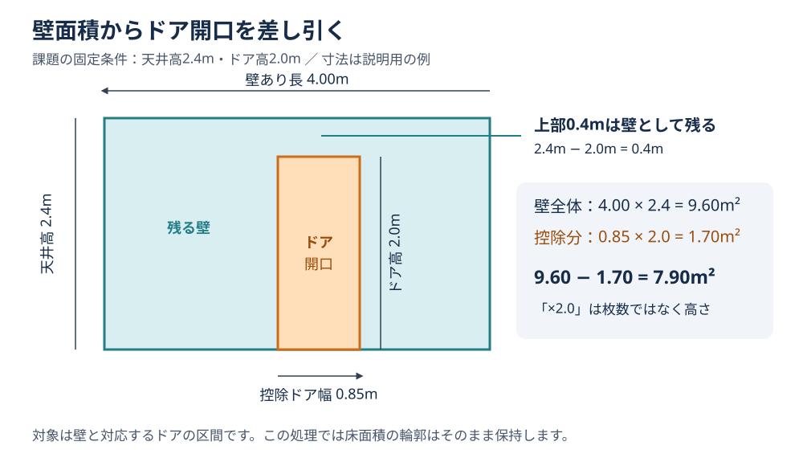
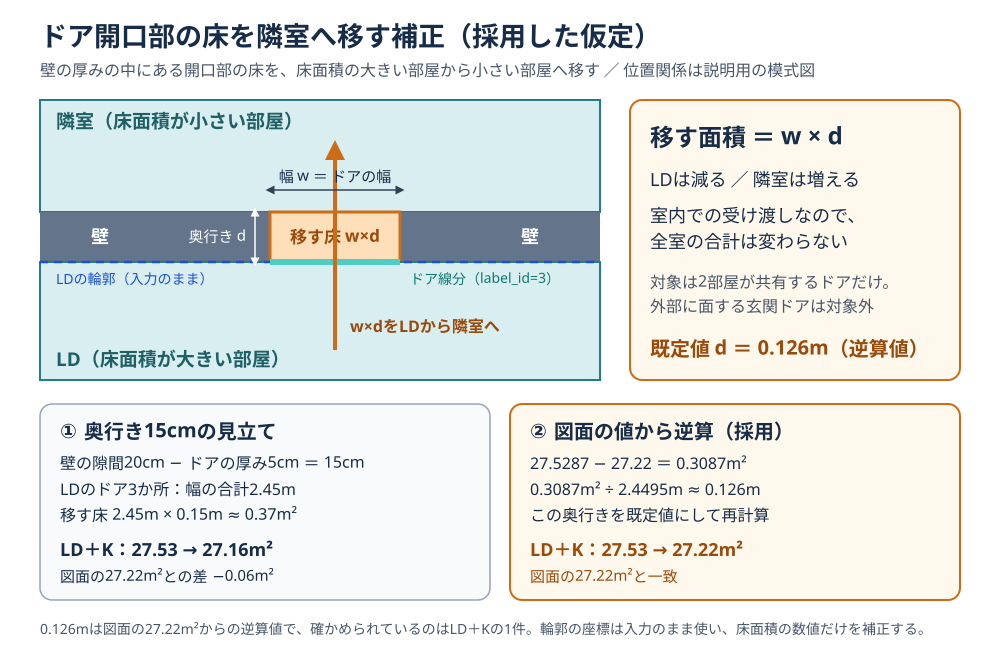
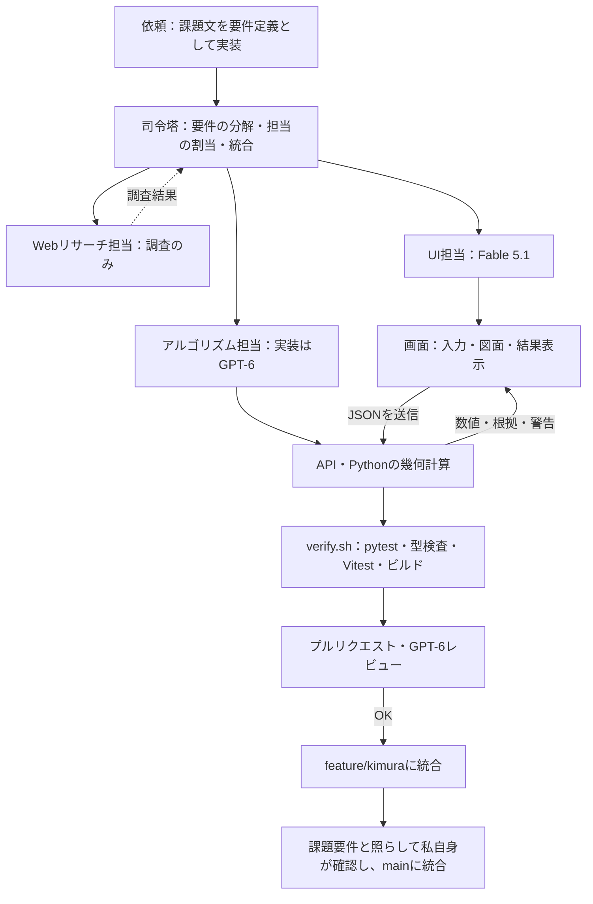

# 平面図 面積・壁面積 解析アプリ

> `main` ブランチには説明資料だけを置いています。アプリ本体は [feature/kimura](https://github.com/Kimurist2024/KKG-kadai/tree/feature/kimura) にあります。以下の起動手順は同ブランチをチェックアウトし、`floorplan-analyzer/` で実行してください（`.claude/scripts/` のコマンドだけはリポジトリ直下で実行します）。

公開サイト: https://floorplan-analyzer-taupe.vercel.app （2026-09-22 にデプロイし、同梱サンプルの解析結果がローカルと表示桁で一致することを HTTP で確認しました）

**部屋・壁・ドアのマスク JSON** を読み込み、部屋ごとの **床面積・周長・壁面積** を算出して、図面と表で確かめられる Web アプリです。

- フロントエンド: Next.js 16.3.5 / React 19.3.0 / TypeScript 5.9.3。図面は SVG で描画しています。
- バックエンド: Python / FastAPI / Pydantic 2 / Shapely 2.0 系。座標から面積を計算します。
- 配置: Vercel で公開しています。Docker Compose と AWS ECS Fargate 用の Terraform は構成ファイルを同梱した段階で、実際に動かしての確認はこれからです。

README に収めなかった詳細は [設計の補足](https://github.com/Kimurist2024/KKG-kadai/blob/feature/kimura/floorplan-analyzer/docs/design-notes.md) と [資料一覧](https://github.com/Kimurist2024/KKG-kadai/blob/feature/kimura/floorplan-analyzer/docs/documents.md) にあります。


## 1. 起動・操作

Python 3.12 と Node.js 22 を推奨します（Node.js は20.9以上）。`floorplan-analyzer/` で実行してください。確認する人が環境構築で止まらないよう、起動は1コマンドにまとめ、初回は依存関係のセットアップも自動で行います。

```bash
./scripts/start.sh   # 起動後、http://localhost:5173 を開く
./scripts/stop.sh    # 停止
```

1. 「JSON ファイルを選択」を押すか、画面に JSON をドロップすると解析します。「サンプルで試す」で同梱のサンプルも開けます。
2. 図面か表から部屋を選ぶと、面積・周長と辺ごとの内訳を確認できます。
3. 拡大・ドラッグ・レイヤー切替で図面を確かめ、結果はCSVで保存できます。

計算条件は **天井高2.4m、ドア高2.0m、96.7px＝1.365m** に固定しています。床面積には、隣室と共有するドアの開口部の床（ドア幅×奥行き0.126m）を移す補正を入れています（6章）。

### UI設計で工夫した点

画面は、計算結果を図面と見比べて確かめられることを重視して設計しました。

- **表と図面の連動**：表と図面が別々だと、数値がどの部屋のものかを目で探すことになります。そこで、表の行と図面の部屋のどちらを選んでも、もう一方で同じ部屋が強調されるようにしました。Escキーか「選択解除」で元に戻せます。
- **計算式と根拠の表示**：解析結果の画面では計算条件と式を常に表示し、部屋を選ぶと辺ごとに「壁あり・壁なし・ドア」の区間と、対応する線分のidまでたどれます。結果が図面の記載とずれたときに、原因の辺を特定できます。
- **壁がない区間の強調**：壁の取りこぼしは壁面積にそのまま響くので、壁なしの長さを表で強調し、壁が見つからない部屋には「要確認」を付けて、確認事項の一覧から対象へ移動できるようにしました。
- **元画像との見比べ**：入力は画像認識の結果なので、ずれを含みます。元画像の上に部屋・壁・ドアを重ね、レイヤー切替・拡大・ドラッグと、選んだ部屋への表示合わせで見比べられます。
- **操作を絞った初期画面**：最初に行う操作はJSONを入れることだけなので、初期画面はドロップ領域と「サンプルで試す」に絞り、操作の流れは使い方ページ（`/guide`）に分けました。
- **結果の持ち出しと操作性**：列の並べ替えとCSV保存に対応し、キーボードだけでも選択でき、狭い画面ではレイアウトが切り替わります。

## 2. 構成と役割

課題の指定（フロントエンドはTypeScriptかJavaScript、バックエンドはPythonで、両者を分離する）に沿って、フロントエンドにはTypeScriptを選び、画面は `frontend/`、入力検証と幾何計算は `backend/app/` に分けました。計算のうち方式を入れ替えて比べたい部分（候補検索・区間の切り取り・自己交差の判定・多角形の作成・重なり候補）は `backend/app/strategies/` に名前つきで登録し、組み合わせを指定して同じ入力で比較できるようにしています。テストは `test/gpt-6/`、同梱の図面は `sample/`、設計と検証の記録は `docs/`、AWS構成は `infra/terraform/`、起動・停止ツールは `scripts/` にあります。

主要なAPIは `POST /api/analyze`（multipartの `file`）と `POST /api/analyze/json`（JSONボディ）の2つで、部屋別・全体の集計、各辺の区間と根拠になる線分のID、警告を返します。ファイル版は不正なJSONを400、容量超過を413で返し、形式や設定の検証エラーは422です。仕様は起動後に `http://127.0.0.1:8000/docs` で確認できます。

環境ごとのAPIの経路とCIは [設計の補足](https://github.com/Kimurist2024/KKG-kadai/blob/feature/kimura/floorplan-analyzer/docs/design-notes.md)、責務の詳細は [ARCHITECTURE](https://github.com/Kimurist2024/KKG-kadai/blob/feature/kimura/floorplan-analyzer/ARCHITECTURE.md)、課題要件との対応は [技術構成と検証状況](https://github.com/Kimurist2024/KKG-kadai/blob/feature/kimura/floorplan-analyzer/docs/architecture.md)、AWSは [インフラ手順](https://github.com/Kimurist2024/KKG-kadai/blob/feature/kimura/floorplan-analyzer/infra/deployment.md) にあります。

### 技術を選んだ理由

- **Next.js（React）**：応募要件にある技術です。画面とAPIの中継（Route Handler）を1つのアプリにまとめられるので、ブラウザから見える接続先を1つにできます。
- **TypeScript**：APIの応答の型を `frontend/src/types.ts` に定義しています。画面側で項目名や型を取り違えると、実行する前に型検査で止まります。
- **図面はSVG**：SVGでは部屋・辺・区間の1つ1つがHTMLの要素になるので、ブラウザがどの要素の上をクリックしたかを判定してくれます。クリック・ホバー・キーボードでの選択は、その要素に付けるだけで済み、拡大しても線はくっきりしたままです。Canvasは1枚の画像として描く仕組みで、描いた後のブラウザは部屋の形を持たないので、クリックされた座標がどの部屋かは自分で調べることになります。部屋ごとの形を自分で保持しておき、クリックやカーソル移動のたびに候補の部屋の形に内外判定（ブラウザの `isPointInPath` か自作の判定）を掛け、ホバーの強調やキーボードでの選択も自分で組む形です。SVGなら、この当たり判定と選択の仕組みをブラウザに任せられます。
- **FastAPI＋Pydantic**：入力のJSONを型で検証し、形式の合わないデータを計算の前で止められます。APIの仕様（`/docs`）も自動で出ます。
- **Shapely（GEOS）**：多角形の処理で必要だったのは、妥当性の検査とその理由の説明、穴、重なりと和集合、部屋名を置く代表点、線分の空間索引（STRtree）です。自作すると境界条件で誤りやすい処理なので、これを1つで満たすShapelyに任せました。GEOSを同梱したパッケージがpipだけで入り（約4MB）、座標を倍精度のまま扱え、配列単位でまとめて呼べる点も決め手です。
- **ほかのライブラリとの比較**：pyclipperは64ビット整数の座標で計算する方式で、小数の座標は倍率を掛けて整数に直す変換を通して渡し、結果を戻す変換が要ります（そのまま渡すと小数点以下が落ちます）。加えて、妥当性の検査と索引は別に用意することになります。CGALを使うscikit-geometryは厳密な計算ができますが、PyPIでは配布されておらず、condaでCGALやBoostなどと一緒に入れることになります。このアプリは起動スクリプトもVercelも `requirements.txt` をpipで入れる構成なので、見送りました。GeoPandasは内部でShapelyを使うライブラリで、加わるのは表形式のデータの機能なので、今回はShapelyだけで足ります。
- **壁とドアの区間計算での工夫**：採用した線分のIDを残すことと、演算の順序を固定して高速化の前後で結果を完全に一致させることが必要でした。そこで、区間の1つ1つに根拠の線分IDを持たせ、併合してもIDが引き継がれるようにしています。順序については、索引で絞った候補を入力順に戻し、実寸への換算と合計を「区間→辺→部屋」の順に固定しました（先に合計してから掛けると、小数の末尾に差が出るためです）。重なった区間を速く処理する端点イベント走査でも、重なりの数だけに集約せず元の区間を記録し、従来と同じ順序で計算しています。変更前の実装を凍結して残し、出力がビット単位で一致することをテストで確かめています。

### 構成上の判断と理由

- **計算はすべてバックエンドに集める**：同じ式を画面側にも持つと二重に確かめることになるので、数値はすべてPythonで計算し、画面を動かさなくてもpytestだけで検証できるようにしました。
- **小数の桁を減らすのは表示するときだけ**：計算の途中では数値をそのまま持ち、画面やCSVに出すときにだけ小数の桁をそろえています（画面は小数第2位）。先に桁を減らしてから足すと、結果が変わってしまうためです。同梱データでも、LD（21.2741m²）とK（6.2546m²）は、小数第2位にしてから足すと27.52m²、足してから小数第2位にすると27.53m²になります。
- **APIは根拠まで返す**：画面は計算をやり直さず、受け取った区間と線分のIDをそのまま表示します。ファイル版は画面用、JSON版はテストや他のプログラム用です。
- **ブラウザは同一オリジンの `/api/*` だけを見る**：接続先はサーバー側の設定（`API_PROXY_TARGET`）で切り替えるので、環境が変わっても画面のコードはそのまま使えます。
- **レスポンスの画像は情報だけ**：元画像はアップロードしたJSONの中にあり、ブラウザ側で取り出せます。送り返すと応答が大きくなるだけなので、幅・高さ・形式・画像の有無という情報だけを返します。

## 3. 面積計算の考え方

### 床面積・周長

入力はまず、部屋（`isLine` が真でない輪郭）、壁（線分・`label_id=2`）、ドア（線分・`label_id=3`）に分けます。名前のない部屋も対象にしています。

- **頂点から計算し直す理由**：JSONに書かれた面積と周長はそのまま使わず、頂点から再計算しています。壁面積も同じ頂点から求めるので床と壁の基準がそろい、記載値との差は入力の検算に使えます（1px²を超えて違えば警告します）。
- **シューレースの公式を選んだ理由**：頂点の外積を順に足すだけで、斜めの辺やL字の部屋でも座標だけから面積が決まります。画素を数える方法と違って解像度に左右されず、計算量も頂点の数に比例するだけです。穴の面積は差し引き、周長は外周と穴の辺の長さを合計します。
- **換算**：長さに `1.365/96.7` を、面積にはその二乗を掛けます。

### 壁面積・ドア控除

- **壁を「辺の上の区間」として求める理由**：輪郭と壁線は完全には重ならず（同梱データでは中央値0.8px、最大7.2pxのずれ）、課題も「壁が存在しない輪郭区間」に注意を求めています。部屋の各辺に壁線を投影して1次元の区間にすれば、壁あり・壁なし・ドアを区間の足し引きで求められ、根拠になった線分のIDも残せます。辺からはみ出した部分は切り落とします。
- **採用条件を角度10°以内・辺から10px以内にした理由**：角度の条件は、T字に突き当たる直交壁や、帯を斜めに横切る短い線分を除くためです（同梱データで採用された壁線の角度は最大1.2°）。10pxは線の幅5pxの2本分で、同梱データでは8〜30pxのどこにしても結果が変わらず、6px以下では壁を取りこぼしました（[実測](https://github.com/Kimurist2024/KKG-kadai/blob/feature/kimura/floorplan-analyzer/docs/design-notes.md)）。
- **区間を整える順番の理由**：重なりの併合→短い区間の除去→隙間の併合→端点の補完、の順です。短い区間を先に除くのは、直交壁の角にできる1〜2pxの重なりが、隙間の併合で膨らんで壁として残るのを防ぐためです。
- **開口**：辺全体から壁のある区間を除いた残りを「壁なし」とするので、区間の内訳と長さの合計が必ず一致します。各辺の結果を部屋ごとに合計します。
- **ドアを1本ずつ扱う理由**：ドアごとに、壁と重なる区間だけを控除します。先にまとめると、壁と重ならないドアのIDが隣のドアに紛れ、ドアの数と警告を誤るためです。両側の壁の隙間とドアが対応する場合は壁区間を補い、警告を出します。

`壁面積 = 壁あり長[m] × 2.4m − 控除ドア幅[m] × 2.0m`

ドア幅に掛けている2.0mは、枚数ではなく高さです。ドアの上部0.4m分は壁として残ります。採用した線分のIDと区間を保持しているので、図面・表・計算式のどこからでも根拠をたどれます。



図は実装済みの壁面積の控除を説明する例です。床面積は、輪郭の座標をそのまま使って頂点から求めた値に、ドア開口部の床の補正（6章）を加えた値です。

**天井高2.4mは課題の計算要件による固定値です。** 同梱の図面には部屋ごとの天井高（CH）が書かれていて、LDKは2,400ですが、Kは2,250、HALLは2,300、PRは2,350、ENTは2,511と部屋によって違います。ドアの高さも、LDKのハイドア（建具符号0724＝幅700mm×高さ2,400mm）は天井まで届くため、2.0mで計算すると上部0.4m分（0.7m×0.4m＝約0.28m²）を壁として数えることになります。今回の壁面積は課題の条件で計算した値で、図面の天井高やドアの高さで計算した実際の壁の面積とは差があります。天井高が2.4mと違う部屋では、壁あり長×（図面の天井高−2.4m）の分だけずれます。

## 4. 高速化：比べる組み合わせを段階的に減らす


**空間探索という発想に至るまで**：縮めたかったのは、JSONを受け取ってから結果を返すまでの解析時間です。最初に試したのは、ドアの射影の使い回しと、尺取り法（二ポインタ）による区間の走査でした。どちらも1本の辺の中の計算（壁やドアの区間を求める部分）を速くするもので、同梱データの解析時間は5%ほど短くなっただけでした。処理を見直すと、図面が大きくなったときに効いてくるのは、1本の辺の中の計算ではなく、「部屋の辺と、壁・ドアの線分を、全部の組み合わせで比べる」部分でした。辺と線分がともに2倍になれば、比べる組は4倍になります。一方、ある辺に関係するのは、その近くにある線分だけです。そこで、計算の前に位置で候補を絞ることにしました。

**外接長方形に行き着いた理由**：尺取り法の延長でx座標だけを並べて絞ると、壁には横向きと縦向きがあるので、横に長い壁がx方向の広い範囲に当てはまって残ってしまいます。そこで、線分を軸に平行な長方形（外接長方形）で囲み、長方形どうしが重なるかどうかで、xとyの両方向を同時に絞ることにしました。

- **第1段：外接長方形の比較**：同梱データでは50辺×30本＝1,500組のうち、実際に壁やドアとして採用されるのは66組（4.4%）だけです。辺の外接長方形を許容距離の10px分だけ広げ、線分の外接長方形と重なるものだけを残すと、大小比較4回の安い判定で198組（13.2%）まで減ります。同梱データの規模では、ここまでで十分でした。
- **第2段：線分が増えたら索引を使う**：第1段の比較もE×N回あるので、線分が増えるとここが重くなります。索引を使えば、検索範囲と重ならない長方形は配下の線分ごと調べずに済みます。ただし索引は作る時間もかかり、同梱データの規模（30本）では索引を使うほうが遅くなりました（外接長方形の走査1.60msに対して、STRtreeを強制すると1.84ms。[計測結果](https://github.com/Kimurist2024/KKG-kadai/blob/feature/kimura/floorplan-analyzer/docs/validation/recent-papers-speed/recent-papers-speed.md)）。そこで、壁とドアがそれぞれ64本以上のときだけ索引を作るようにしています。
- **AABB木を先に考えた**：外接長方形（AABB）を階層にまとめた索引として、最初に思いついたのはAABB木でした。AABB木は外接長方形を2つずつ包んでいく二分木で、3Dのメッシュや当たり判定でよく使われます。ただ、調べてみると、Shapelyに入っているSTRtreeも同じ外接長方形で候補を絞る索引で、違いは長方形をどう木にまとめるかにありました。STRtree（Sort-Tile-Recursive）は、全要素を座標で並べ替えてタイル状に区切り、複数の子を持つ節でまとめて詰めるR-treeです。線分は解析の最初にすべてそろい、その後は固定なので、この一括で詰める作り方が合います。
- **AABB木を見送った理由**：AABB木は自分でPythonで書くことになります。STRtreeはC言語で書かれたGEOSの実装をShapely経由で使え、全辺分を1回の呼び出しで問い合わせられるので、比較の回数が同じでもPythonの木より速いと見込めます。加えて、同梱データで候補検索の処理を測ると解析時間の約9%（1.51msのうち0.14ms）で、索引を替えても短くできる時間はその範囲に限られました。そこで、依存を増やさず実装の手間もかからないSTRtreeを採り、点を対象にするKD木と、長く細い壁線（同梱データで長さの中央値129px・最大717px、幅5px）が多くのマスにまたがる格子も見送りました。
- **結果を保つための決まり**：どの段でも候補を絞るだけで、壁として採用するかは角度・垂直距離・射影区間で判定します。候補は元の入力順に並べ直し、計算の順序を高速化の前と同じに保っています。同じ入力の幾何計算の結果は最大8件・16MiB・5分間を上限に使い回し、重なった区間の処理には端点イベント走査を入れました。

課題で配布されたJSONそのもので、変更前と現行を交互に101回測りました。初回解析は2.94ms→1.96ms（1.50倍）、設定を変えた再解析は2.93ms→0.88ms（3.3倍）で、結果はbit単位で一致します。変更前の凍結コピーにはドア開口部の補正が無いので、この比較は補正を無効（奥行き0）にし、補正で増えた項目を除いた共通の出力で行っています（[同梱JSONでの速度確認](https://github.com/Kimurist2024/KKG-kadai/blob/feature/kimura/floorplan-analyzer/docs/validation/sample-speed/sample-speed.md)）。内訳では辺ごとの処理とShapelyの呼び出しが大半だったので、2026年の論文にある「GEOSを配列単位でまとめて呼ぶ」考え方を取り入れ、部屋ごとに呼んでいたShapelyの処理を一括にしました。この変更で初回解析は2.32msから1.98msになっています（[直近の論文による高速化](https://github.com/Kimurist2024/KKG-kadai/blob/feature/kimura/floorplan-analyzer/docs/validation/recent-papers-speed/recent-papers-speed.md)）。

図の読み方は [設計の補足](https://github.com/Kimurist2024/KKG-kadai/blob/feature/kimura/floorplan-analyzer/docs/design-notes.md)、ほかの計測は [アルゴリズム性能検証](https://github.com/Kimurist2024/KKG-kadai/blob/feature/kimura/floorplan-analyzer/docs/validation/algorithm-performance/report.md)、[計算結果を変えない高速化](https://github.com/Kimurist2024/KKG-kadai/blob/feature/kimura/floorplan-analyzer/docs/validation/exact-speed/exact-speed.md)、[表示処理の性能検証](https://github.com/Kimurist2024/KKG-kadai/blob/feature/kimura/floorplan-analyzer/docs/selection-performance.md) にあります。

## 5. 輪郭の基準と注意点

床面積は、入力された輪郭が囲む範囲を基本にして、隣室と共有するドアの開口部の床を移す補正（6章）を加えたものです。輪郭そのものは入力のまま使い、内法（壁の室内側）として扱っています。内法と壁芯（壁の中心）のどちらを通っているかはJSONからは分からないためです。

図面の記載面積との差には、開口部の床を隣室へ配分する仮定を採用し、奥行きは図面の値に合わせて逆算した値にしています（6章）。輪郭の位置や壁厚が効く場合の試算は [設計の補足](https://github.com/Kimurist2024/KKG-kadai/blob/feature/kimura/floorplan-analyzer/docs/design-notes.md) に残しています。研究用の方向・共有境界の補正は通常計算と分けており、[幾何補正の説明](https://github.com/Kimurist2024/KKG-kadai/blob/feature/kimura/floorplan-analyzer/docs/geometry-regularization.md) にまとめています。

- 壁は、向きがほぼ平行で辺から10px以内にある線分を対応付けます。共有壁は隣り合う部屋それぞれの内壁として両面を数えます。控除の対象はドアだけです。
- 自己交差・面積0・不正な穴の輪郭は、警告を出して計算から外します。部屋どうしの重なりは、部屋別の面積をそのままにして和集合の面積を併記します。
- 「壁が足りない」という警告や対応率20%未満の表示は、目で確かめてほしい箇所の目印です。最後は図面と照らして確認する使い方を想定しています。

## 6. 検証・AIの活用

同梱の11部屋を合計すると **床面積48.75m²、壁面積155.54m²** になります。頂点座標から求めたLD＋Kは27.53m²で、図面に書かれている27.22m²より約1%大きく、下の補正を入れた表示値は27.22m²です。

同梱11部屋では、頂点座標から求めた面積・周長とJSONの記載値を同じ縮尺で換算すると、表示桁まで一致します。また、高速化の前後でテスト対象の計算結果が一致することを確認しています。これらは入力データとの整合性と高速化時の結果の維持を確かめる検証です。図面の記載面積との差は、次のドア開口部の補正で説明しています。

同梱データには、隣り合う部屋の輪郭どうしが重なっている箇所が9か所あります（合計0.18m²で、床面積合計の約0.4%）。部屋別の床面積は各部屋の輪郭から求めた値をそのまま表示し、合計には重複を除いた床面積（48.58m²）を併記して、図面には紫の斜線で示しました。

検証は、同梱サンプル・境界条件・変更前後の比較をpytestとVitestで行いました。

### 採用した補正：ドア開口部の床を隣室へ移す

頂点座標からの面積は、LD＋Kで図面より0.31m²大きい値でした。壁の厚みの中にあるドア開口部の床が、図面ではLD側に数えられていないと考え、隣室と共有するドアについて「ドア幅×奥行き」の床を、床面積の大きい部屋から小さい部屋へ移す補正を入れました。LDのドア3か所（幅の合計2.45m）の分がLDから洗面所・未命名 #3・ホールへ移り、LD＋Kは27.22m²になります。室内の受け渡しなので全室の合計48.75m²は変わらず、外部に面する玄関ドアは対象外です。



図の橙色の部分が移す床で、幅 `w` はドアの幅、奥行き `d` は壁の厚みの中で床が続く長さです。奥行きの見立て「壁の隙間20cm−ドアの厚み5cm＝15cm」では27.16m²（図面との差−0.2%）で、既定値の0.126mは図面の27.22m²から逆算した値です（0.3087m²÷2.45m）。この逆算値は図面やJSONから読み取った寸法ではなく、図面に記載がある面積はLDKの1つだけなので、確かめられているのはLD＋Kの1件です。ほかの図面で成り立つかはこの1件からは判断できないので、奥行きの設定（APIの `door_opening_depth_m`）を0にすると補正前の値で計算できます。実装の正しさは補正の妥当性とは分けて確かめていて、同じ開口をドア1本で表しても隣接する2本や重なった2本で表しても移す面積が同じになることをテストにしています。ドアの開く向きもJSONには無いため、移す向きは「床面積の大きい部屋から小さい部屋へ」という規則で決めています。画面では部屋を選ぶと「頂点からの面積±開口部の床＝床面積」の内訳を表示し（移す側は減算、受け取る側は加算）、CSVにも補正前の値と増減を出します。各部屋の値は [サンプル結果](https://github.com/Kimurist2024/KKG-kadai/blob/feature/kimura/floorplan-analyzer/docs/validation/sample-results.md)、試算の経緯は [設計の補足](https://github.com/Kimurist2024/KKG-kadai/blob/feature/kimura/floorplan-analyzer/docs/design-notes.md) にあります。

### 自分で判断・改善した点

- **補正の前提を整理した**：ドアの厚みだけでなく、輪郭の位置や壁厚も面積に影響する候補として検討しました。そのうえで、輪郭の座標は入力のまま保ち、開口部の床は隣室の床として数える（全室の合計は変わらない）と決めて、ドア開口部の補正だけを採用し、奥行きの既定値は図面の値からの逆算値にしました。
- **高速化の順番と条件を決めた**：まず計測し、扉投影の重複をなくす→区間処理の改善→STRtree→結果の使い回し、の順を指定しました。区間の走査にいもす法の発想を使う案も出しています。条件は「計算結果が一切ずれないこと」です。
- **ビームサーチを見送った理由**：ビームサーチは、点数の高い上位の候補だけを残し、残りは調べずに捨てて速くする方法です。この計算では、辺に沿う線分はどれも壁やドアの区間になるので、捨てた中に本物が1本でもあれば、壁の長さや控除するドアの幅が変わります。同梱データでも50辺のうち16辺には2本以上の線分が乗っていて（最多は玄関の辺で、壁1本とドア2本）、1本の辺に何本乗るかは図面によって変わります。何件残せば安全かを決められないので、関係のない線分だけを確実に外せる方法（許容距離の分だけ広げた外接長方形と、索引）を選びました。
- **測り方を疑った**：複製で作った人工データでの速度が、実際の図面にも当てはまるかは確かめようがないと考え、配布されたJSONで測り直しました。すると初回解析が3.02ms→3.88msと逆に遅くなっていました。原因は、結果をキャッシュに登録するときに、辞書への変換と検証のやり直しが挟まっていたことです。この往復をやめて応答を直接組み立て、線分が64本未満のときの総当たりにも外接長方形での絞り込みを入れて、2.30msまで縮めました。
- **想定する規模を決めた**：図面の線分は多くても1,000本程度と見て、数百万件を前提にした索引の手法は対象から外しました。同梱データの内訳では辺ごとの処理とShapelyの呼び出しが大半だったので、部屋・辺ごとの固定費を削る方針にしました。
- **輪郭の重なりに気づいた**：JSONの座標を自分で確認していて、隣り合う部屋の輪郭が重なっている箇所があることに気づきました。そこで、重なりを検出して警告し、部屋別の面積は入力どおりのまま、合計に重複を除いた値を併記するようにしました。図面上の強調表示も、外接円では重なりの形が分かりにくかったので、形に沿った縁取りに変えています。

### 使用したプロンプト

開発の初期に数回に分けて出した指示を、1つにまとめたものです。

> 添付の課題文（PDFとkadai.md）を要件定義として読み、これを満たすWebアプリを作ってほしい。応募要件にあるNext.js・FastAPI・Docker・Terraformなどは、このタスクで使えるところに使う。動くものができたら、より良くするためにオーケストレーションを組みたい。UI作成・アルゴリズム・Webリサーチを担当するサブエージェントを作るべきだと考えている。文章と計画の作成にはFable 5.1を使う。課題文は毎回最優先で読むこと。まず単体テストを作る。GitHubではブランチを分けて`feature/kimura`を作り、1サイクルごとにプルリクエストを出してCodexにレビューさせ、正しいと確認できたものだけを統合する。mainへの統合は、自分で動かして確かめてから行う。

ゴールは数値を出すことだけでなく、**採用した線分IDと区間を保持し、図面・表・計算式から根拠を追えること**に置きました。根拠をたどれない数値は、検証も修正もできないからです。

共通プロンプトは `.claude/scripts/`、役割は `.claude/agents/`、文章とmainへの反映の判断基準は `.claude/skills/`、レビューの記録は `floorplan-analyzer/docs/reviews/` に残しています。

### AIの使い方

AIの活用が認められている課題なので、コードを生成させること自体よりも**AIの出力を私自身が確かめて保証できる状態を先に作ること**を目標にしました。

- 画面・API・幾何計算で責務を分け、数値計算はPythonに集約して、計算の正しさを画面と切り離して確認できるようにしました。
- 守らせたい規約は文章で指示せず、`verify.sh`の終了コードで判定するゲートにしました。
- 実装は担当ごとに分け（UIはFable 5.1、バックエンドはGPT-6）、レビューは実装とは別のセッションのGPT-6に任せて、書き手と評価者を分けました。GPT-6はCodex（OpenAIのコーディング用CLI）から呼び出しています。最後は課題要件と照らして私自身が採否を判断します。

### サブエージェントの体制と1サイクルの流れ



### 検証の実行方法

初回は `floorplan-analyzer/` で `backend/.venv/bin/python -m pip install -r backend/requirements-dev.txt` を実行してテスト用の依存を入れ、リポジトリ直下で検証します（仮想環境は起動スクリプトが作ります）。

```bash
.claude/scripts/verify.sh quick  # pytest・型検査・Vitest
.claude/scripts/verify.sh all    # 上記と本番ビルド
backend/.venv/bin/python scripts/compare_algorithms.py   # アルゴリズムの組み合わせを同じ入力で比較（floorplan-analyzer/ で実行）
```

コードの変更は作業ブランチで検証し、レビューを経て `feature/kimura` に統合しています。mainへの反映は私が手動で行います（[開発手順](https://github.com/Kimurist2024/KKG-kadai/blob/feature/kimura/floorplan-analyzer/docs/orchestration.md)）。

## 7. 参考文献

各資料の詳しい使い方は、引用している各文書（[資料一覧](https://github.com/Kimurist2024/KKG-kadai/blob/feature/kimura/floorplan-analyzer/docs/documents.md) からたどれます）に書いています。

### 論文・解説記事

実装の中心になった3件に絞っています。検討して見送ったものを含むほかの論文は、[直近の論文による高速化](https://github.com/Kimurist2024/KKG-kadai/blob/feature/kimura/floorplan-analyzer/docs/validation/recent-papers-speed/recent-papers-speed.md)、[計算結果を変えない高速化](https://github.com/Kimurist2024/KKG-kadai/blob/feature/kimura/floorplan-analyzer/docs/validation/exact-speed/exact-speed.md)、[幾何補正の説明](https://github.com/Kimurist2024/KKG-kadai/blob/feature/kimura/floorplan-analyzer/docs/geometry-regularization.md) に載せています。

- Leutenegger ほか [STR: A Simple and Efficient Algorithm for R-Tree Packing](https://www.cs.odu.edu/~mln/ltrs-pdfs/icase-1997-14.pdf)（1997）：空間データを矩形でまとめて木にし、検索候補を絞るアルゴリズムの論文。Shapely の STRtree の基礎で、4章の候補検索の根拠にしました。
- [いもす法の原著者による解説](https://imoz.jp/algorithms/imos_method.html)（2012）：区間の出入り口だけを記録して重なりを数える手法の解説。重複区間の走査で「開始・終了のイベントだけを見る」発想に使いました（被覆数ではなく区間 ID を保持する形に変えています）。
- Fleischmann ほか [GeoPandas: Fundamental data structures for vector spatial data in Python](https://doi.org/10.1016/j.compenvurbsys.2026.102495)（2026）：GEOSを配列単位でまとめて呼んで速くする設計を述べた論文。部屋ごとに呼んでいたShapelyの処理を一括呼び出しに変える根拠にしました（4章）。

### 公式ドキュメント

- [pydantic_core.to_json](https://docs.pydantic.dev/latest/api/pydantic_core/#pydantic_core.to_json)：Pydantic の JSON 書き出し関数の仕様。キャッシュの書き出しに使いました。
- [OpenAI 公式 AGENTS.md ガイド](https://learn.chatgpt.com/docs/agent-configuration/agents-md)：Codex 向けの指示ファイルの書き方の仕様。開発ハーネスの設定に使いました。
