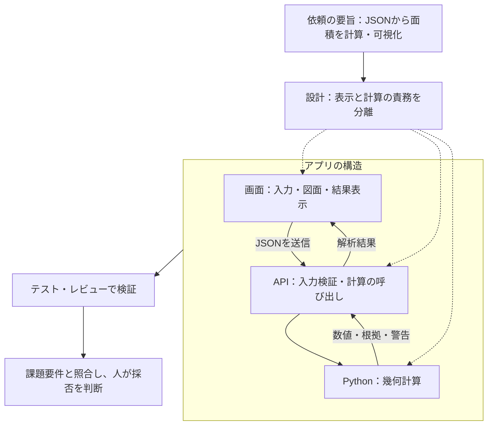

# 平面図 面積・壁面積 解析アプリ

> `main` ブランチには説明資料だけを置いています。アプリ本体は [feature/kimura](https://github.com/Kimurist2024/KKG-kadai/tree/feature/kimura) にあります。以下の起動手順は同ブランチをチェックアウトし、`floorplan-analyzer/` で実行してください（`.claude/scripts/` のコマンドだけはリポジトリ直下で実行します）。

公開サイト: https://floorplan-analyzer-taupe.vercel.app （2026-09-18 に API の疎通を確認しました。このとき、公開環境での解析処理と画面操作までは再検証していません）

**部屋・壁・ドアのマスク JSON** を読み込み、部屋ごとの **床面積・周長・壁面積** を算出する Web アプリです。
提出用の画面は、JSON のアップロードと固定条件での解析に絞りました。

- フロントエンド: Next.js 16.3.5 App Router / React 19.3.0 / TypeScript 5.9.3（`frontend/package-lock.json` で固定）。図面は SVG で描画しています。
- バックエンド: Python / FastAPI / Pydantic 2 / Shapely 2.0 系。Uvicorn で起動し、座標から面積を計算します。
- 公開用の設定: Vercel Services で Next.js と FastAPI を分け、`/api/*` は FastAPI、それ以外は Next.js に振り分けています。
- 別の配置方法: Docker Compose と、AWS ECS Fargate 用の Terraform を同梱しました。ローカル・Compose・AWS では Next.js の API プロキシを通します。

部屋を選んだときの表示処理の改善と計測結果は [性能検証](https://github.com/Kimurist2024/KKG-kadai/blob/feature/kimura/floorplan-analyzer/docs/selection-performance.md) にまとめました。
面積・壁・扉の計算を速くしたときの、変更前後の全項目比較は [アルゴリズム性能検証](https://github.com/Kimurist2024/KKG-kadai/blob/feature/kimura/floorplan-analyzer/docs/validation/algorithm-performance/report.md) にあります。
直前の実装を基準にした最新の高速化と、浮動小数点まで完全に一致することの検証、論文調査は [計算結果を変えない高速化](https://github.com/Kimurist2024/KKG-kadai/blob/feature/kimura/floorplan-analyzer/docs/validation/exact-speed/exact-speed.md) に書きました。目標にしていた100倍には届いていません。
さらに5倍を目指した [端点イベント走査の実測](floorplan-analyzer/docs/validation/interval-sweep/interval-sweep.md) では、人工的な1,024頂点の輪郭で初回解析が7.9〜11.1倍になりました。ただし同梱図面ではほぼ同じ速さで、すべての入力で5倍という目標も未達です。
与えられた同梱の JSON そのもので本当に速くなったかは、変更前（2026-09-14 時点の実装）と現行を交互に101回測って [同梱JSONでの速度確認](https://github.com/Kimurist2024/KKG-kadai/blob/feature/kimura/floorplan-analyzer/docs/validation/sample-speed/sample-speed.md) にまとめました。初回解析は 3.02ms → 3.88ms で速くなっておらず（結果をキャッシュに登録する分だけ約0.9ms 遅い）、速くなるのは設定を変えて再解析するとき（2.98ms → 0.91ms、約3.3倍）です。

課題要件との対応と、動作確認をどこまで行ったかは [技術構成と検証状況](https://github.com/Kimurist2024/KKG-kadai/blob/feature/kimura/floorplan-analyzer/docs/architecture.md)、AWS の手順は [インフラ手順](https://github.com/Kimurist2024/KKG-kadai/blob/feature/kimura/floorplan-analyzer/infra/deployment.md) を参照してください。


---

## 1. 起動・操作

Python 3.12 と Node.js 22 を推奨します（CI・Docker と同じ構成です。Node.js の下限は20.9にしています）。以下は `floorplan-analyzer/` で実行してください。

```bash
./scripts/start.sh   # 起動完了後、http://localhost:5173 を開く
./scripts/stop.sh    # 停止
```

起動スクリプトは、8000番と5173番を使っているプロセスを止めてから、依存関係のセットアップとサーバー起動を行います。互いに依存しない処理は並列に走らせています。

1. 初回は同梱のサンプルを表示します。操作の説明は画面上部の「はじめての方へ」から読めます。
2. 手持ちのJSONを選ぶかドロップすると、固定条件で解析します。
3. 図面か表から部屋を選ぶと、面積・周長と辺ごとの内訳を確認できます。
4. 拡大・ドラッグ・レイヤー切替で図面を確かめ、結果はCSVで保存できます。

計算条件は **天井高2.4m、ドア高2.0m、96.7px＝1.365m** に固定しています。画面の表示倍率は計算値に影響しません。通常画面では幾何補正を無効にしました。

ローカルでは `http://127.0.0.1:8000/api/health` でAPIの疎通を、`http://127.0.0.1:8000/docs` で仕様を確認できます。8000番にアプリの画面はありません。コンテナで動かす場合は `docker compose up --build` で、画面は `http://localhost:3000` です。Compose ではバックエンドの8000番をホストに公開していません。

## 2. 構成と役割

- `frontend/`：Next.js・React・TypeScript。図面、結果表、計算式、CSVを担当します。
- `backend/app/`：FastAPI。入力検証と幾何計算をここに集めています。
- `test/gpt-6/`：フロント・バックのテスト。`backend/benchmarks/`：性能比較。
- `sample/`：同梱の図面。`docs/`：設計・参考文献・検証記録。
- `infra/terraform/`：AWS構成。`scripts/`：起動・停止ツール。

ブラウザは同一オリジンの `/api/*` に通信します。環境ごとの経路は次のとおりです。

| 環境 | API の経路 | 設定の根拠 |
|---|---|---|
| ローカル | Next.js :5173 → FastAPI :8000 | `scripts/start.sh`、`frontend/src/app/api/[...path]/route.ts` |
| Vercel | Services のルーティング → FastAPI（Next.js のプロキシを通さない） | `vercel.json` |
| Compose | Next.js :3000 → backend:8000 | `compose.yaml` |
| AWS（構成を同梱） | HTTPS ALB → Next.js :3000 → 同じタスクの FastAPI :8000 | `infra/terraform/app/main.tf` |

プロキシの接続先はサーバー側の `API_PROXY_TARGET` で指定します。以前の単一 Function 構成で使っていた `api/index.py` は互換のために残していますが、現在の Vercel Services 設定では使っていません。アプリ直下の `requirements.txt` は `backend/requirements.txt` を参照しています。

数値はすべてバックエンドで計算し、丸めるのは表示するときだけです。元画像はブラウザ側でも取り出して表示しますが、アップロードするJSON自体は画像データを含めたままバックエンドへ送ります。解析レスポンスには画像を含めていません。座標と区間の計算はPython、多角形の穴・重複・和集合はShapely/GEOSに任せています。

主要なAPIは `POST /api/analyze`（multipartの `file`）と `POST /api/analyze/json`（JSONボディ）の2つです。部屋別・全体の集計に加えて、各辺の区間と根拠になる線分のID、警告を返します。ファイル版は不正なJSONを400、容量超過を413で返し、形式や設定の検証エラーは422です。通常画面の条件は固定ですが、API側には条件指定と研究用の幾何補正の設定を残しています。

GitHub Actions には、Pythonとフロントエンドのテスト、本番ビルド、Composeの疎通、Terraformの検証を定義しています。AWSの更新は main を対象にした手動実行で、CIの成功と環境設定が前提です。説明資料しかない今の main では実行できず、コードと workflow を統合してからになります。構成ファイルがあることと、AWSで動作確認したこととは別です。

それぞれの責務は [ARCHITECTURE](https://github.com/Kimurist2024/KKG-kadai/blob/feature/kimura/floorplan-analyzer/ARCHITECTURE.md)、開発手順は [CONTRIBUTING](https://github.com/Kimurist2024/KKG-kadai/blob/feature/kimura/floorplan-analyzer/CONTRIBUTING.md)、環境変数と配置は [技術構成](https://github.com/Kimurist2024/KKG-kadai/blob/feature/kimura/floorplan-analyzer/docs/architecture.md) と [インフラ手順](https://github.com/Kimurist2024/KKG-kadai/blob/feature/kimura/floorplan-analyzer/infra/deployment.md) を参照してください。

## 3. 面積計算の考え方

### 床面積・周長

入力はまず、部屋（`isLine` が真でない輪郭）、壁（線分・`label_id=2`）、ドア（線分・`label_id=3`）に分けます。名前のない部屋も対象にしています。

床面積は、頂点の外積を順に足していく **シューレースの公式** で求めます。穴の面積は差し引き、周長は外周と穴それぞれの辺の長さを合計します。実寸への換算は、長さに `1.365/96.7` を、面積にはその二乗を掛けます。JSONに書かれている面積はそのまま使わず、頂点から計算し直しています。

### 壁面積・ドア控除

輪郭と壁線は完全には重ならないので、部屋の各辺に線分を投影して「辺のどの範囲に壁があるか」を区間として求めることにしました。

1. **対応付け**：角度差が10°以内で、壁線の両端が辺の延長線から10px以内なら射影し、辺からはみ出した部分を切り落とします。
2. **壁区間の整理**：重なりを併合し、極端に短いノイズを除いてから、小さな隙間と端点のずれを補います。
3. **開口の特定**：辺全体から壁のある区間を除いた残りを「壁なし」とします。
4. **ドア控除**：ドアごとに射影し、壁と重なる区間だけを控除します。両側の壁の隙間とドアが対応する場合は壁区間を補い、警告を出します。
5. **集計**：各辺の結果を部屋ごとに合計します。

`壁面積 = 壁あり長[m] × 2.4m − 控除ドア幅[m] × 2.0m`

ドア幅に掛けている2.0mは、枚数ではなく高さです。ドアの上部0.4m分は壁として残ります。採用した線分のIDと区間を保持しているので、図面・表・計算式のどこからでも根拠をたどれます。ドアを先にまとめず、壁との交差を1本ずつ取っているのは、対応しないドアのIDが混ざるのを防ぐためです。

## 4. R-treeによる高速化


図の読み方：①橙の輪郭の下辺が計算対象の辺で、その周りの破線が検索範囲です。AとBは壁そのものではなく、近くにある線分をまとめた領域を表しています。②木をたどると、領域Bは検索範囲と重ならないので配下ごと調べません。領域Aは重なるので中を見ますが、a3は自分の外接長方形が検索範囲に入らないため外れ、a1とa2が候補に残ります。③残った候補を角度・距離・射影区間で判定し、平行で近いa1を壁として採用、垂直なa2を角度で除外します。領域が重なることと壁として採用することは別、というのがこの図の要点です。配置や縮尺、木の分岐は説明用の模式図です。

部屋の辺がE本、壁とドアの線分がN本あると、素直に総当たりするとE×N組の比較になります。この組み合わせを減らすために、Shapelyの **STRtree（R-tree系の空間インデックス）** を使いました。

STRtreeは、各線分をx軸・y軸に平行な長方形で囲み、近いものどうしをさらに大きな長方形にまとめて木の形にしたものです。検索範囲が上位の長方形と重ならなければ、その配下の線分は一本も調べずに済みます。遠くにある線分をまとめて候補から外せるのが利点です。

検索の起点は部屋の中心ではなく、いま計算している1本の辺です。その辺の外接長方形を、許容距離の10pxと丸め誤差分だけ上下左右に広げ、x・y両方向で重なる線分を候補にします。ここまでは候補を絞っているだけで、壁として採用するかどうかは、その後に角度・垂直距離・射影区間で判定します。斜めの辺でも手順は同じです。

検索にかかる時間は通常O(log N＋k)（kは候補数）が目安ですが、線分が密集していると候補がほとんど減らないこともあります。木を作る時間や候補を並べ直す時間もかかるので、どんな入力でも速くなると言い切ることはできません。壁とドアがそれぞれ64本未満のときは、木を作らずに全件を確認しています。また、候補は元の入力順に並べ直してから処理し、木を使う前と計算の順序が変わらないようにしました。

このほか、同じ入力に対する幾何計算の結果は、最大8件・16MiB・5分間を上限にプロセス内へ保持して使い回します。端点イベント走査も加え、重なった区間や頂点の多い輪郭で起きていた無駄な比較を減らしました。ビームサーチのように候補を上位だけに打ち切る近似は使っていません。速度は、何と比べるか・どの入力か・キャッシュが効いているかで変わるので、実測した範囲は冒頭に挙げた検証資料に分けて記録しています。

## 5. 輪郭の基準と注意点

[図が表示されない場合はこちら](floorplan-analyzer/docs/images/room-boundary-wall-reference-v2.png)


今回は、入力された輪郭が囲む範囲をそのまま部屋の床とみなして計算しています。つまり輪郭を内法（室内側の境界）として扱い、壁厚による補正はしていません。壁は、向きがほぼ平行で辺から10px以内にある線分をその辺の壁とみなして対応付けます。この許容距離は壁線と輪郭のずれを吸収するためのもので、壁厚を表す値ではありません。

こう決めたのは、同梱データの輪郭がどの基準で引かれているのか、実際の壁厚がどれくらいなのかがJSONからは分からないためです。上の図はその違いを示した概念図で、輪郭が内法を通っているのか、壁の中心（壁芯）を通っているのかで、本来必要になる処理は変わります。

- **内法の場合**：今回の扱いと一致します。壁厚による補正は要りません。
- **壁芯の場合**：内法に直すには壁厚が必要です。壁のある辺を室内側へ寄せ、ずれた分だけ角を作り直すことになります。今回の扱いでは、床面積が内法より大きめに出ます。
- **認識ずれの場合**：そもそも輪郭が壁とうまく対応していない可能性があるので、まず対応関係と基準を確かめるところからです。原因を確かめないまま一律に動かすと、かえって誤差が大きくなることがあります。

壁芯から内法への変換と、認識誤差の修正はまったく別の話なので、壁厚が分からない状態で推測で輪郭を動かすことはしませんでした。同梱サンプルではLD＋Kが図面の記載値に近い結果になっていますが、それだけで輪郭の基準を断定はしていません。研究用に用意した補正の実装（方向の正則化）については、[幾何補正の説明](https://github.com/Kimurist2024/KKG-kadai/blob/feature/kimura/floorplan-analyzer/docs/geometry-regularization.md) にあります。

このほかにも、次のような制約があります。

- 共有壁は、隣り合う部屋それぞれの内壁として両面を数えます。窓は控除の対象にしていません。
- 小さな隙間を埋める処理を入れているため、実際にある開口まで塞いでしまうことがあります。また、平行な辺が近くに並んでいると、同じ線分が両方の辺に対応してしまう場合があります。
- 自己交差している輪郭、面積が0の輪郭、不正な穴は、警告を出したうえで計算から外します。部屋どうしが重なっている場合も警告しますが、部屋ごとの面積はそのままにして、重複を除いた和集合の面積を併記します。
- 「壁が足りない」という警告や、対応率が20%未満という表示は、あくまで目で確かめてほしい箇所の目印です。壁面積が0の部屋や、警告が出なかった部屋も含めて、最後は図面と照らして確認してください。警告はデータの中で検出できた不整合を示すもので、図面との一致そのものを判定しているわけではありません。

## 6. 検証・AIの活用

同梱の11部屋を合計すると **床面積48.75m²、壁面積155.54m²** になります。LD＋Kは27.52m²で、図面に書かれた27.22m²とは約1%の差があります。この差は計算手順の誤差ではなく、輪郭がどこを通っているかの問題だと切り分けています。頂点座標から求めた面積・周長はJSONに記載された値と表示桁まで一致しており、高速化の前後でも結果が完全に一致することをテストで確認しているためです。差が計算値の大きい側に出ていることは、前章の定義（輪郭を内法として扱う）のもとで、輪郭が内法よりわずかに外側を通っているか、認識のずれがある可能性と整合します。輪郭の基準と壁厚が分かれば、そこを起点に詰められる差だと考えています。

UIは図面・表・辺番号を連動させ、警告から対象へたどれるようにしました。ズーム、ドラッグ、CSV、狭い画面とキーボード操作に対応しています。計算はサンプル、境界条件、変更前後の比較で検証し、高速化のときも数値・ID・警告・配列の順序が変わっていないことを確認しました。

初期プロンプトの要旨と設計上の工夫（原文未確認のため、課題文・設計記録から再構成）：

出発点の依頼は「平面図の解析結果JSONから、部屋ごとの床面積・周長・壁面積を計算して画面で確認できるようにする」ことでした。ただし数値を出すだけでは足りず、**採用した線分IDと区間を保持し、図面・表・計算式から根拠を追えること**をゴールに置いています。JSON記載の面積をそのまま採用せず頂点から再計算する以上、根拠をたどれない数値は検証も修正もできないからです。

AIの活用が認められている課題なので、コードを生成させること自体よりも**AIの出力を人が保証できる状態を先に作ること**を目標にしました。そのために画面・API・幾何計算で責務を分け、数値計算はPythonに集約して、計算の正しさを画面の実装から切り離して確認できるようにしています。

守らせたい規約は文章で指示するのではなく、`verify.sh`の終了コードで判定するゲートに落としました。実装（Codex）とレビュー（別セッション）で書き手と評価者を分け、最後は課題要件と照らして人が採否を判断します。



共通プロンプトは `.claude/scripts/`、役割は `.claude/agents/`、検討やレビューの記録は `floorplan-analyzer/docs/reviews/` に残しています。実施していない検証を成功扱いにはしていません。

初回は `floorplan-analyzer/` で `backend/.venv/bin/python -m pip install -r backend/requirements-dev.txt` を実行し、テスト用の依存も入れてください（仮想環境は起動スクリプトが作ります）。その後、リポジトリ直下で検証します。

```bash
.claude/scripts/verify.sh quick  # pytest・型検査・Vitest
.claude/scripts/verify.sh all    # 上記と本番ビルド
```

通常のコード変更は作業ブランチで検証し、レビューを経て `feature/kimura` に統合しています。mainへの反映は私が手動で行います。詳細は [開発手順](https://github.com/Kimurist2024/KKG-kadai/blob/feature/kimura/floorplan-analyzer/docs/orchestration.md)、参考文献と追加の検証は [資料一覧](https://github.com/Kimurist2024/KKG-kadai/blob/feature/kimura/floorplan-analyzer/docs/documents.md) を参照してください。

## 7. 参考文献

各資料の詳しい使い方は、引用している各文書（[資料一覧](https://github.com/Kimurist2024/KKG-kadai/blob/feature/kimura/floorplan-analyzer/docs/documents.md) からたどれます）に書いています。

### 論文・解説記事

- Leutenegger ほか [STR: A Simple and Efficient Algorithm for R-Tree Packing](https://www.cs.odu.edu/~mln/ltrs-pdfs/icase-1997-14.pdf)（1997）：空間データを矩形でまとめて木にし、検索候補を絞るアルゴリズムの論文。Shapely の STRtree の基礎で、4章の候補検索の根拠にしました。
- Boncz ほか [MonetDB/X100: Hyper-Pipelining Query Execution](https://www.cidrdb.org/cidr2005/papers/P19.pdf)（CIDR 2005）：データベースの処理をベクトル単位にまとめて速くする論文。辺ごとの検索呼び出しを部屋の輪郭単位にまとめる発想に使いました。
- Amdahl [Validity of the Single Processor Approach to Achieving Large Scale Computing Capabilities](https://www.cs.cmu.edu/~18742/papers/Amdahl1967.pdf)（1967）：一部だけを速くしても全体の高速化には限りがあることを示した論文。速度は解析全体で測るという評価方針の根拠です。
- Liu ほか [Raster-to-Vector: Revisiting Floorplan Transformation](https://openaccess.thecvf.com/content_ICCV_2017/html/Liu_Raster-to-Vector_Revisiting_Floorplan_ICCV_2017_paper.html)（ICCV 2017）：ラスタ画像の平面図から部屋や壁のベクトル表現を復元する研究。研究用の幾何補正で「局所ではなく全体の接続関係で整える」考え方の参考にしました。
- Chen ほか [Floor-SP: Inverse CAD for Floorplans by Sequential Room-wise Shortest Path](https://openaccess.thecvf.com/content_ICCV_2019/html/Chen_Floor-SP_Inverse_CAD_for_Floorplans_by_Sequential_Room-Wise_Shortest_Path_ICCV_2019_paper.html)（ICCV 2019）：部屋ごとの最短経路探索で平面図の輪郭を求める研究。上と同じ考え方の参考にしました。
- Chen ほか [HEAT: Holistic Edge Attention Transformer for Structured Reconstruction](https://openaccess.thecvf.com/content/CVPR2022/html/Chen_HEAT_Holistic_Edge_Attention_Transformer_for_Structured_Reconstruction_CVPR_2022_paper.html)（CVPR 2022）：辺どうしの関係を全体で捉えて構造を復元する研究。上と同じ考え方の参考にしました。
- [いもす法の原著者による解説](https://imoz.jp/algorithms/imos_method.html)（2012）：区間の出入り口だけを記録して重なりを数える手法の解説。重複区間の走査で「開始・終了のイベントだけを見る」発想に使いました（被覆数ではなく区間 ID を保持する形に変えています）。

### 公式ドキュメント

- [pydantic_core.to_json](https://docs.pydantic.dev/latest/api/pydantic_core/#pydantic_core.to_json)：Pydantic の JSON 書き出し関数の仕様。キャッシュの書き出しに使いました。
- [OpenAI 公式 AGENTS.md ガイド](https://learn.chatgpt.com/docs/agent-configuration/agents-md)：Codex 向けの指示ファイルの書き方の仕様。開発ハーネスの設定に使いました。

### 検証に使った外部図面

- [UR 都市機構 S2 建築図 ver1.1](https://www.ur-net.go.jp/rd_portal/UR-BIM/jni4dd0000001wmv-att/03_kenchikuzu_S2_ver1.1.pdf)：1階の用途別色分図。L字を含む 8 区画を、同梱データ以外の図面での計算精度の検証に使いました。
- [Countryside Kenora / Candlewood Homes Mini Homes](https://b9f0a121-a2f4-4be4-a8a0-ebf384c417bf.filesusr.com/ugd/0dcb7e_6ad37e587a4b47f7baebde4c7abafb32.pdf)：寸法つきの小規模住宅（2寝室）の平面図。同じ検証に使いました。
