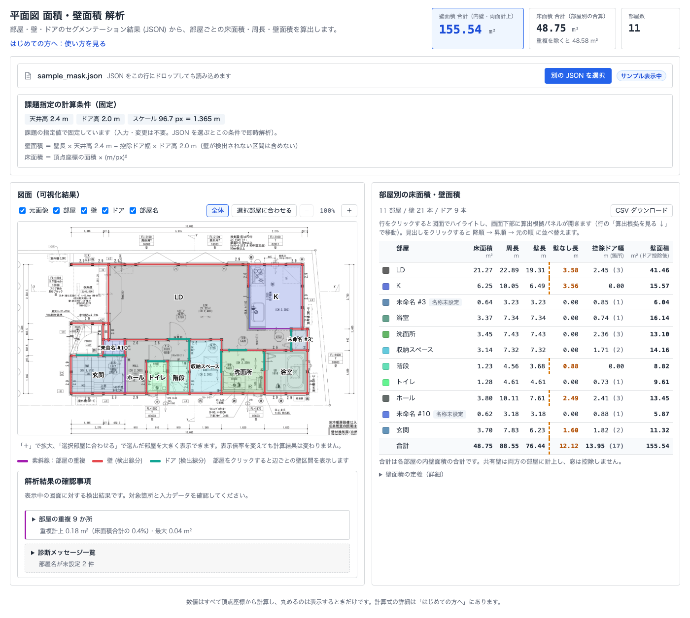
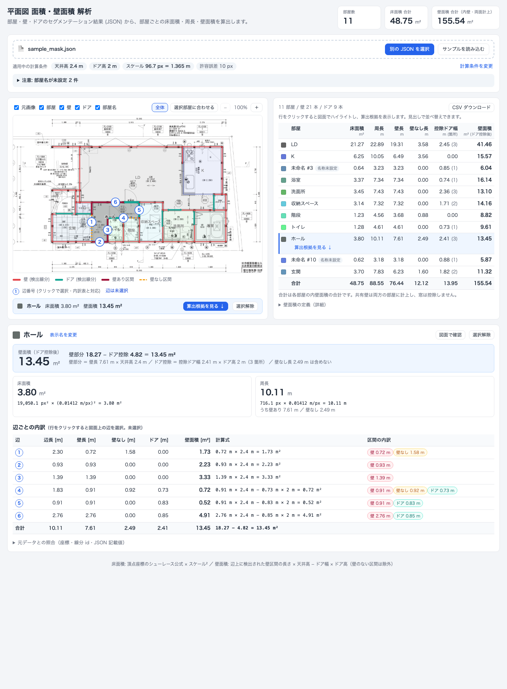
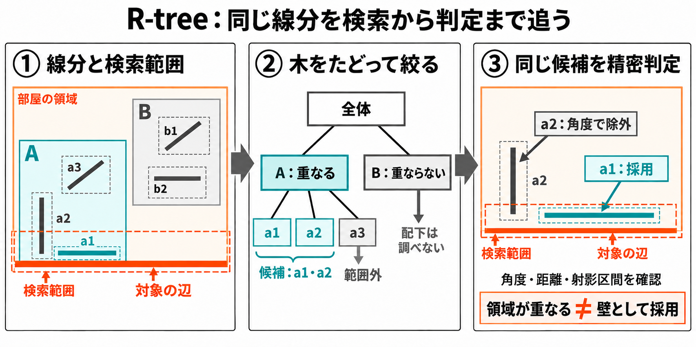
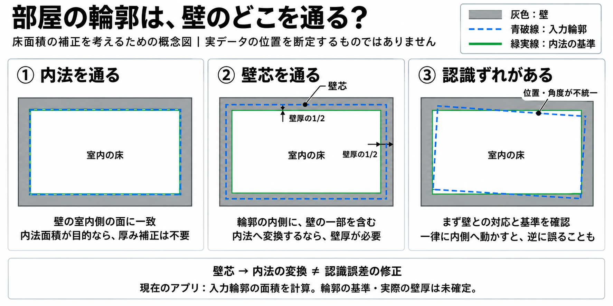
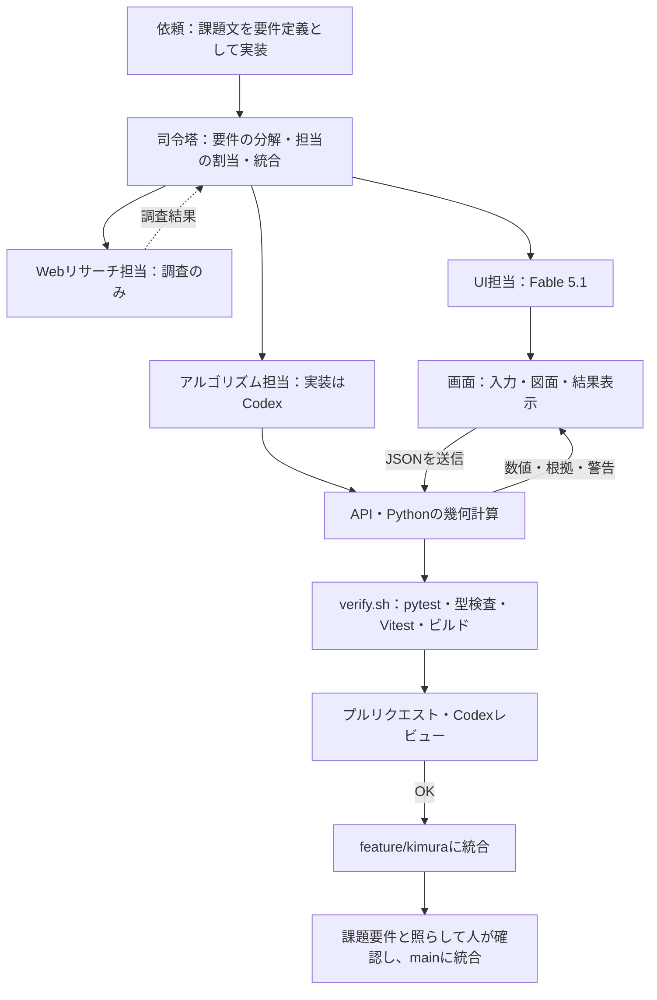

# 平面図 面積・壁面積 解析アプリ

> `main` ブランチには説明資料だけを置いています。アプリ本体は [feature/kimura](https://github.com/Kimurist2024/KKG-kadai/tree/feature/kimura) にあります。以下の起動手順は同ブランチをチェックアウトし、`floorplan-analyzer/` で実行してください（`.claude/scripts/` のコマンドだけはリポジトリ直下で実行します）。

公開サイト: https://floorplan-analyzer-taupe.vercel.app （2026-09-19 にデプロイし、同梱サンプルの解析結果がローカルと表示桁で一致することを HTTP で確認しました）

**部屋・壁・ドアのマスク JSON** を読み込み、部屋ごとの **床面積・周長・壁面積** を算出して、図面と表で確かめられる Web アプリです。

- フロントエンド: Next.js 16.3.5 / React 19.3.0 / TypeScript 5.9.3。図面は SVG で描画しています。
- バックエンド: Python / FastAPI / Pydantic 2 / Shapely 2.0 系。座標から面積を計算します。
- 配置: Vercel で公開し、Docker Compose と AWS ECS Fargate 用の Terraform も同梱しました。

README に収めなかった詳細は [設計の補足](https://github.com/Kimurist2024/KKG-kadai/blob/feature/kimura/floorplan-analyzer/docs/design-notes.md) と [資料一覧](https://github.com/Kimurist2024/KKG-kadai/blob/feature/kimura/floorplan-analyzer/docs/documents.md) にあります。




## 1. 起動・操作

Python 3.12 と Node.js 22 を推奨します（Node.js は20.9以上）。`floorplan-analyzer/` で実行してください。確認する人が環境構築で止まらないよう、起動は1コマンドにまとめ、初回は依存関係のセットアップも自動で行います。

```bash
./scripts/start.sh   # 起動後、http://localhost:5173 を開く
./scripts/stop.sh    # 停止
```

1. 「JSON ファイルを選択」を押すか、画面に JSON をドロップすると解析します。「サンプルで試す」で同梱のサンプルも開けます。
2. 図面か表から部屋を選ぶと、面積・周長と辺ごとの内訳を確認できます。
3. 拡大・ドラッグ・レイヤー切替で図面を確かめ、結果はCSVで保存できます。

計算条件は **天井高2.4m、ドア高2.0m、96.7px＝1.365m** に固定しています。Docker で動かす場合は `docker compose up --build`（画面は `http://localhost:3000`）です。

### UI設計で工夫した点

面積は、図面と見比べて初めて信用できる数値です。そこで画面は「出てきた数値が正しいかを、利用者が自分で確かめられること」を軸に設計しました。

- **表と図面の連動**：表と図面が別々だと、数値がどの部屋のものかを目で探すことになります。そこで、表の行と図面の部屋のどちらを選んでも、もう一方で同じ部屋が強調されるようにしました。Escキーか「選択解除」で元に戻せます。
- **計算式と根拠の表示**：計算条件と式は常に表示し、部屋を選ぶと辺ごとに「壁あり・壁なし・ドア」の区間と、対応する線分のidまでたどれます。結果が図面の記載とずれたときに、原因の辺を特定できます。
- **壁がない区間の強調**：壁の取りこぼしは壁面積にそのまま響くので、壁なしの長さを表で強調し、壁が見つからない部屋には「要確認」を付けて、確認事項の一覧から対象へ移動できるようにしました。
- **元画像との見比べ**：入力は画像認識の結果なので、ずれを含みます。元画像の上に部屋・壁・ドアを重ね、レイヤー切替・拡大・ドラッグと、選んだ部屋への表示合わせで見比べられます。
- **操作を絞った初期画面**：最初に行う操作はJSONを入れることだけなので、初期画面はドロップ領域と「サンプルで試す」に絞り、操作の流れは使い方ページ（`/guide`）に分けました。
- **結果の持ち出しと操作性**：列の並べ替えとCSV保存に対応し、キーボードだけでも選択でき、狭い画面ではレイアウトが切り替わります。

## 2. 構成と役割

課題の指定（フロントエンドはTypeScript、バックエンドはPythonで分離）を前提に、画面は `frontend/`、入力検証と幾何計算は `backend/app/` に分けました。テストは `test/gpt-6/`、同梱の図面は `sample/`、設計と検証の記録は `docs/`、AWS構成は `infra/terraform/`、起動・停止ツールは `scripts/` にあります。

主要なAPIは `POST /api/analyze`（multipartの `file`）と `POST /api/analyze/json`（JSONボディ）の2つで、部屋別・全体の集計、各辺の区間と根拠になる線分のID、警告を返します。ファイル版は不正なJSONを400、容量超過を413で返し、形式や設定の検証エラーは422です。仕様は起動後に `http://127.0.0.1:8000/docs` で確認できます。

環境ごとのAPIの経路とCIは [設計の補足](https://github.com/Kimurist2024/KKG-kadai/blob/feature/kimura/floorplan-analyzer/docs/design-notes.md)、責務の詳細は [ARCHITECTURE](https://github.com/Kimurist2024/KKG-kadai/blob/feature/kimura/floorplan-analyzer/ARCHITECTURE.md)、課題要件との対応は [技術構成と検証状況](https://github.com/Kimurist2024/KKG-kadai/blob/feature/kimura/floorplan-analyzer/docs/architecture.md)、AWSは [インフラ手順](https://github.com/Kimurist2024/KKG-kadai/blob/feature/kimura/floorplan-analyzer/infra/deployment.md) にあります。

### 技術を選んだ理由

- **Next.js（React）**：応募要件にある技術です。画面とAPIの中継（Route Handler）を1つのアプリにまとめられるので、ブラウザから見える接続先を1つにできます。
- **TypeScript**：APIの応答の型を `frontend/src/types.ts` に定義しています。画面側で項目名や型を取り違えると、実行する前に型検査で止まります。
- **図面はSVG**：部屋・辺・区間の1つ1つが要素になるので、クリック・ホバー・キーボードでの選択をそのまま付けられ、拡大しても線がくっきりしたままです。Canvasだと当たり判定を自前で持つことになります。
- **FastAPI＋Pydantic**：入力のJSONを型で検証し、形式の合わないデータを計算の前で止められます。APIの仕様（`/docs`）も自動で出ます。
- **Shapely（GEOS）**：多角形の処理で必要だったのは、妥当性の検査とその理由の説明、穴、重なりと和集合、部屋名を置く代表点、線分の空間索引（STRtree）です。自作すると境界条件で誤りやすい処理なので、これを1つで満たすShapelyに任せました。GEOSを同梱したパッケージがpipだけで入り（約4MB）、座標を倍精度のまま扱え、配列単位でまとめて呼べる点も決め手です。
- **ほかのライブラリとの比較**：pyclipperは重なりの計算が速い反面、座標を整数に直して渡す方式なので入力の座標が丸められ、妥当性の検査と索引は別に用意することになります。CGALを使うscikit-geometryは厳密ですが、導入にCGALの環境が要り、1コマンドで起動する構成やVercelへの配置では扱いが重くなります。GeoPandasは内部でShapelyを使うライブラリで、加わるのは表形式のデータの機能なので、今回はShapelyだけで足ります。
- **壁とドアの区間計算は自前のPython**：採用した線分のIDを残すことと、演算の順序を固定して高速化の前後で結果を完全に一致させることが必要だったので、ライブラリに任せず自分で書いています。

### 構成上の判断と理由

- **計算はすべてバックエンドに集める**：同じ式を画面側にも持つと二重に確かめることになるので、数値はすべてPythonで計算し、画面を動かさなくてもpytestだけで検証できるようにしました。
- **丸めるのは表示するときだけ**：途中で丸めると、部屋ごとの値を足した結果と全体の合計が合わなくなるためです。
- **APIは根拠まで返す**：画面は計算をやり直さず、受け取った区間と線分のIDをそのまま表示します。ファイル版は画面用、JSON版はテストや他のプログラム用です。
- **ブラウザは同一オリジンの `/api/*` だけを見る**：接続先はサーバー側の設定（`API_PROXY_TARGET`）で切り替えるので、環境が変わっても画面のコードはそのまま使えます。
- **レスポンスの画像情報は幅と高さだけ**：元画像はアップロードしたJSONの中にあり、ブラウザ側で取り出せます。送り返すと応答が大きくなるだけなので、幅と高さだけを返します。

## 3. 面積計算の考え方

### 床面積・周長

入力はまず、部屋（`isLine` が真でない輪郭）、壁（線分・`label_id=2`）、ドア（線分・`label_id=3`）に分けます。名前のない部屋も対象にしています。

- **頂点から計算し直す理由**：JSONに書かれた面積と周長はそのまま使わず、頂点から再計算しています。壁面積も同じ頂点から求めるので床と壁の基準がそろい、記載値との差は入力の検算に使えます（1px²を超えて違えば警告します）。
- **シューレースの公式を選んだ理由**：頂点の外積を順に足すだけで、斜めの辺やL字の部屋でも座標だけから面積が決まります。画素を数える方法と違って解像度に左右されず、計算量も頂点の数に比例するだけです。穴の面積は差し引き、周長は外周と穴の辺の長さを合計します。
- **換算**：長さに `1.365/96.7` を、面積にはその二乗を掛けます。

### 壁面積・ドア控除

- **壁を「辺の上の区間」として求める理由**：輪郭と壁線は完全には重ならず（同梱データでは中央値0.8px、最大7.2pxのずれ）、課題も「壁が存在しない輪郭区間」に注意を求めています。部屋の各辺に壁線を投影して1次元の区間にすれば、壁あり・壁なし・ドアを区間の足し引きで求められ、根拠になった線分のIDも残せます。辺からはみ出した部分は切り落とします。
- **採用条件を角度10°以内・辺から10px以内にした理由**：角度の条件は、T字に突き当たる直交壁や、帯を斜めに横切る短い線分を除くためです（同梱データで採用された壁線の角度は最大1.2°）。10pxは線の幅5pxの2本分で、同梱データでは8〜30pxのどこにしても結果が変わらず、6px以下では壁を取りこぼしました（[実測](https://github.com/Kimurist2024/KKG-kadai/blob/feature/kimura/floorplan-analyzer/docs/design-notes.md)）。
- **区間を整える順番の理由**：重なりの併合→短い区間の除去→隙間の併合→端点の補完、の順です。短い区間を先に除くのは、直交壁の角にできる1〜2pxの重なりが、隙間の併合で膨らんで壁として残るのを防ぐためです。
- **開口**：辺全体から壁のある区間を除いた残りを「壁なし」とするので、区間の内訳と長さの合計が必ず一致します。各辺の結果を部屋ごとに合計します。
- **ドアを1本ずつ扱う理由**：ドアごとに、壁と重なる区間だけを控除します。先にまとめると、壁と重ならないドアのIDが隣のドアに紛れ、ドアの数と警告を誤るためです。両側の壁の隙間とドアが対応する場合は壁区間を補い、警告を出します。

`壁面積 = 壁あり長[m] × 2.4m − 控除ドア幅[m] × 2.0m`

ドア幅に掛けている2.0mは、枚数ではなく高さです。ドアの上部0.4m分は壁として残ります。採用した線分のIDと区間を保持しているので、図面・表・計算式のどこからでも根拠をたどれます。

## 4. 高速化：比べる組み合わせを段階的に減らす



部屋の辺がE本、壁とドアの線分がN本あると、総当たりではE×N組を調べることになります。同梱データでは50辺×30本＝1,500組ですが、実際に壁やドアとして採用されるのは66組（4.4%）だけです。大半は遠くにあって調べる必要のない組なので、安い判定から順に候補を減らす形にしました。

- **第1段：外接長方形の比較**：辺の外接長方形を許容距離の10px分だけ広げ、線分の外接長方形と重なるものだけを残します。大小比較4回で済み、角度・距離・射影の計算よりずっと安いからです。同梱データではこれだけで1,500組が198組（13.2%）に減ります。同梱データの規模では、ここまでで十分でした。
- **第2段：線分が増えたら索引を使う**：第1段の比較もE×N回あるので、線分が増えるとここが重くなります（990本で約160万回）。索引を使えば、検索範囲と重ならない長方形は配下の線分ごと調べずに済みます。ただし索引は作る時間もかかるので、実測で約180本から速くなることを確かめたうえで、壁とドアがそれぞれ64本以上のときだけ作るようにしました。990本では総当たりより約25%短くなります。
- **索引にSTRtreeを選んだ理由**：線分は解析の最初にすべてそろい、その後は固定です。STRtree（Sort-Tile-Recursive）は、そろったデータを並べ替えて一括で詰めるR-treeで、1本ずつ挿入して作る方式よりノードを隙間なく詰められます。問い合わせが「広げた長方形と重なる長方形を探す」というR-treeがそのまま答えられる形であること、Shapelyに含まれていて依存を増やさず、全辺分を1回の呼び出しで問い合わせられることも理由です。
- **KD木や格子と比べた結果**：KD木は点を対象にした索引で、広がりのある線分を入れるには別の工夫が要ります。格子は、壁線が長く細い（同梱データで長さの中央値129px・最大717px、幅5px）ために1本が多くのマスにまたがり、マスの大きさの調整も必要になります。
- **結果を保つための決まり**：どの段でも候補を絞るだけで、壁として採用するかは角度・垂直距離・射影区間で判定します。候補は元の入力順に並べ直し、計算の順序を高速化の前と同じに保っています。同じ入力の幾何計算の結果は最大8件・16MiB・5分間を上限に使い回し、重なった区間の処理には端点イベント走査を入れました。

課題で配布されたJSONそのもので、変更前と現行を交互に101回測りました。初回解析は2.94ms→1.96ms（1.50倍）、設定を変えた再解析は2.93ms→0.88ms（3.3倍）で、結果はbit単位で一致します（[同梱JSONでの速度確認](https://github.com/Kimurist2024/KKG-kadai/blob/feature/kimura/floorplan-analyzer/docs/validation/sample-speed/sample-speed.md)）。

図面の線分は多くても1,000本程度と想定し、30〜990本でも測りました。この範囲では索引の選び方より部屋・辺ごとの固定費のほうが大きかったので、2026年の論文にある「GEOSを配列単位でまとめて呼ぶ」考え方で固定費を削りました（[直近の論文による高速化](https://github.com/Kimurist2024/KKG-kadai/blob/feature/kimura/floorplan-analyzer/docs/validation/recent-papers-speed/recent-papers-speed.md)）。

図の読み方は [設計の補足](https://github.com/Kimurist2024/KKG-kadai/blob/feature/kimura/floorplan-analyzer/docs/design-notes.md)、ほかの計測は [アルゴリズム性能検証](https://github.com/Kimurist2024/KKG-kadai/blob/feature/kimura/floorplan-analyzer/docs/validation/algorithm-performance/report.md)、[計算結果を変えない高速化](https://github.com/Kimurist2024/KKG-kadai/blob/feature/kimura/floorplan-analyzer/docs/validation/exact-speed/exact-speed.md)、[表示処理の性能検証](https://github.com/Kimurist2024/KKG-kadai/blob/feature/kimura/floorplan-analyzer/docs/selection-performance.md) にあります。

## 5. 輪郭の基準と注意点



床面積は、輪郭が壁のどこを通っているかで大きく変わります。同梱データでは1pxが約1.4cmにあたり、輪郭を室内側へ1px寄せるだけでLD＋Kの面積は1.7%、壁線の幅の半分（2.5px）寄せると4.2%小さくなります。計算式をどれだけ正確にしても、この基準の違いのほうがずっと大きいということです。最初はドアの厚みの補正が要ると考えていましたが、面積に効くのは壁のほうだと気づき、輪郭が壁の内側（内法）を通る場合と中心（壁芯）を通る場合を上の図に整理しました。

JSONから読み取れるのは座標までで、輪郭の基準と壁厚は別に確かめる必要があります。そこで今回は、入力された輪郭が囲む範囲をそのまま部屋の床とみなし、輪郭を内法（室内側の境界）として計算しています。

- **内法の場合**：今回の扱いと一致します。
- **壁芯の場合**：内法に直すには壁厚が必要で、今回の扱いでは床面積が内法より大きめに出ます。
- **認識ずれの場合**：輪郭と壁の対応関係と基準を確かめるところからになります。

壁厚が分からないまま推測で輪郭を動かすと誤差の原因が増えるだけなので、輪郭は入力のまま使っています。研究用に用意した補正（方向の正則化）は [幾何補正の説明](https://github.com/Kimurist2024/KKG-kadai/blob/feature/kimura/floorplan-analyzer/docs/geometry-regularization.md) にあります。

- 壁は、向きがほぼ平行で辺から10px以内にある線分を対応付けます。共有壁は隣り合う部屋それぞれの内壁として両面を数えます。控除の対象はドアだけです。
- 自己交差・面積0・不正な穴の輪郭は、警告を出して計算から外します。部屋どうしの重なりは、部屋別の面積をそのままにして和集合の面積を併記します。
- 「壁が足りない」という警告や対応率20%未満の表示は、目で確かめてほしい箇所の目印です。最後は図面と照らして確認する使い方を想定しています。

## 6. 検証・AIの活用

同梱の11部屋を合計すると **床面積48.75m²、壁面積155.54m²** になります。LD＋Kは27.52m²で、図面に書かれている27.22m²より約1%大きい値です。

この差は計算の誤りではなく、輪郭の引かれ方によるものだと考えています。頂点座標から求めた面積と周長はJSONに記載された値と表示桁まで一致し、高速化の前後で結果が完全に一致することもテストで確認しているからです。

同梱データには、隣り合う部屋の輪郭どうしが重なっている箇所が9か所あります（合計0.18m²で、床面積合計の約0.4%）。部屋別の床面積は入力どおりに表示し、合計には重複を除いた床面積（48.58m²）を併記して、図面には紫の斜線で示しました。

検証は、同梱サンプル・境界条件・変更前後の比較をpytestとVitestで行いました。公開図面を使った精度の確認は [外部図面での検証](https://github.com/Kimurist2024/KKG-kadai/blob/feature/kimura/floorplan-analyzer/docs/validation/REPORT.md) にまとめています。

### 自分で判断・改善した点

コードの多くはAIに書かせましたが、どの案を採るか、出てきた結果が正しいかは自分で確かめて決めました。

- **入力欄をなくした**：天井高・ドア高・縮尺は課題文で決まっているので、入力させずに固定条件ですぐ解析する画面に作り直しました。使わなくなった画像AIの機能もコードごと外しています。
- **補正すべき対象を考え直した**：最初はドアの厚みの補正が要ると考えましたが、面積に効くのは壁のほうだと気づき、輪郭が壁のどこを通るかを図に整理しました（5章の図）。
- **高速化の順番と条件を決めた**：まず計測し、扉投影の重複をなくす→区間処理の改善→STRtree→結果の使い回し、の順を指定しました。区間の走査にいもす法の発想を使う案も出しています。条件は「計算結果が一切ずれないこと」で、候補を上位だけに絞るビームサーチは、この条件に合わないので見送りました。
- **測り方を疑った**：複製で作った人工データは正しさを確かめようがないと考え、配布されたJSONで測り直しました。すると初回解析が3.02ms→3.88msと逆に遅くなっていました。原因は、結果をキャッシュに登録するときに、辞書への変換と検証のやり直しが挟まっていたことです。この往復をやめて応答を直接組み立て、線分が64本未満のときの総当たりにも外接長方形での絞り込みを入れて、2.30msまで縮めました。
- **想定する規模を決めた**：図面の線分は多くても1,000本程度と見て、大規模データ向けの索引の工夫は対象から外しました。30〜990本で測ると時間は部屋の数にほぼ比例し、索引による差は最大でも約25%だったので、部屋・辺ごとの固定費を削る方針にしました。
- **警告を座標で確かめた**：「部屋が重なっている」という警告が本当かをJSONの座標で確認し、実在したので、合計にだけ重複を除いた値を併記しました。強調表示も外接円から形に沿った縁取りに変えています。
- **AIの提案を見直した**：「初期表示でサンプルの結果を見せる」案は一度採用しましたが、実際の画面で見ると見栄えが悪かったので、人が選んだときだけ表示する形に戻しました。

### 使用したプロンプト

開発の初期に数回に分けて出した指示を、1つにまとめたものです。

> 添付の課題文（PDFとkadai.md）を要件定義として読み、これを満たすWebアプリを作ってほしい。応募要件にあるNext.js・FastAPI・Docker・Terraformなどは、このタスクで使えるところに使う。動くものができたら、より良くするためにオーケストレーションを組みたい。UI作成・アルゴリズム・Webリサーチを担当するサブエージェントを作るべきだと考えている。文章と計画の作成にはFable 5.1を使う。課題文は毎回最優先で読むこと。まず単体テストを作る。GitHubではブランチを分けて`feature/kimura`を作り、1サイクルごとにプルリクエストを出してCodexにレビューさせ、正しいと確認できたものだけを統合する。mainへの統合は、自分で動かして確かめてから行う。

ゴールは数値を出すことだけでなく、**採用した線分IDと区間を保持し、図面・表・計算式から根拠を追えること**に置きました。根拠をたどれない数値は、検証も修正もできないからです。

共通プロンプトは `.claude/scripts/`、役割は `.claude/agents/`、文章とmainへの反映の判断基準は `.claude/skills/`、レビューの記録は `floorplan-analyzer/docs/reviews/` に残しています。

### AIの使い方

AIの活用が認められている課題なので、コードを生成させること自体よりも**AIの出力を人が保証できる状態を先に作ること**を目標にしました。

- 画面・API・幾何計算で責務を分け、数値計算はPythonに集約して、計算の正しさを画面と切り離して確認できるようにしました。
- 守らせたい規約は文章で指示せず、`verify.sh`の終了コードで判定するゲートにしました。
- 実装は担当ごとに分け（UIはFable 5.1、バックエンドはCodex）、レビューは実装とは別のセッションのCodexに任せて、書き手と評価者を分けました。最後は課題要件と照らして人が採否を判断します。

### サブエージェントの体制と1サイクルの流れ



### 検証の実行方法

初回は `floorplan-analyzer/` で `backend/.venv/bin/python -m pip install -r backend/requirements-dev.txt` を実行してテスト用の依存を入れ、リポジトリ直下で検証します（仮想環境は起動スクリプトが作ります）。

```bash
.claude/scripts/verify.sh quick  # pytest・型検査・Vitest
.claude/scripts/verify.sh all    # 上記と本番ビルド
```

コードの変更は作業ブランチで検証し、レビューを経て `feature/kimura` に統合しています。mainへの反映は私が手動で行います（[開発手順](https://github.com/Kimurist2024/KKG-kadai/blob/feature/kimura/floorplan-analyzer/docs/orchestration.md)）。

## 7. 参考文献

各資料の詳しい使い方は、引用している各文書（[資料一覧](https://github.com/Kimurist2024/KKG-kadai/blob/feature/kimura/floorplan-analyzer/docs/documents.md) からたどれます）に書いています。

### 論文・解説記事

- Leutenegger ほか [STR: A Simple and Efficient Algorithm for R-Tree Packing](https://www.cs.odu.edu/~mln/ltrs-pdfs/icase-1997-14.pdf)（1997）：空間データを矩形でまとめて木にし、検索候補を絞るアルゴリズムの論文。Shapely の STRtree の基礎で、4章の候補検索の根拠にしました。
- Boncz ほか [MonetDB/X100: Hyper-Pipelining Query Execution](https://www.cidrdb.org/cidr2005/papers/P19.pdf)（CIDR 2005）：データベースの処理をベクトル単位にまとめて速くする論文。辺ごとの検索呼び出しを部屋の輪郭単位にまとめる発想に使いました。
- Amdahl [Validity of the Single Processor Approach to Achieving Large Scale Computing Capabilities](https://www.cs.cmu.edu/~18742/papers/Amdahl1967.pdf)（1967）：一部だけを速くしても全体の高速化には限りがあることを示した論文。速度は解析全体で測るという評価方針の根拠です。
- Liu ほか [Raster-to-Vector: Revisiting Floorplan Transformation](https://openaccess.thecvf.com/content_ICCV_2017/html/Liu_Raster-to-Vector_Revisiting_Floorplan_ICCV_2017_paper.html)（ICCV 2017）：ラスタ画像の平面図から部屋や壁のベクトル表現を復元する研究。研究用の幾何補正で「局所ではなく全体の接続関係で整える」考え方の参考にしました。
- Chen ほか [Floor-SP: Inverse CAD for Floorplans by Sequential Room-wise Shortest Path](https://openaccess.thecvf.com/content_ICCV_2019/html/Chen_Floor-SP_Inverse_CAD_for_Floorplans_by_Sequential_Room-Wise_Shortest_Path_ICCV_2019_paper.html)（ICCV 2019）：部屋ごとの最短経路探索で平面図の輪郭を求める研究。上と同じ考え方の参考にしました。
- Chen ほか [HEAT: Holistic Edge Attention Transformer for Structured Reconstruction](https://openaccess.thecvf.com/content/CVPR2022/html/Chen_HEAT_Holistic_Edge_Attention_Transformer_for_Structured_Reconstruction_CVPR_2022_paper.html)（CVPR 2022）：辺どうしの関係を全体で捉えて構造を復元する研究。上と同じ考え方の参考にしました。
- [いもす法の原著者による解説](https://imoz.jp/algorithms/imos_method.html)（2012）：区間の出入り口だけを記録して重なりを数える手法の解説。重複区間の走査で「開始・終了のイベントだけを見る」発想に使いました（被覆数ではなく区間 ID を保持する形に変えています）。

### 2026年の論文（高速化の検討に使用）

- Fleischmann ほか [GeoPandas: Fundamental data structures for vector spatial data in Python](https://doi.org/10.1016/j.compenvurbsys.2026.102495)（2026）：GEOSを配列単位でまとめて呼んで速くする設計を述べた論文。部屋ごとに呼んでいたShapelyの処理を一括呼び出しに変える根拠にしました（採用）。
- Pai ほか [Evaluating Learned Spatial Indexes](https://arxiv.org/abs/2606.19034)（2026）：索引の構築コストが何回の問い合わせで回収できるかを実験で比べた論文。線分が少ないときは木を作らない切り替えの根拠にしました。
- Mandarapu, Kunkunuru [The Decode-Work Law](https://arxiv.org/abs/2607.01182)（2026）：結果を変えずに、厳密な判定の前に安い判定で候補を確定させる論文。早期判定を試しましたが、同梱データでは計測値がほぼ同じだったので見送りました。
- Mahathevan ほか [Splyce: SIMD Vectorization of Sparse Coiteration](https://arxiv.org/abs/2609.19410)（2026）：ソート済みの列を走査するループから分岐を減らす論文。区間の併合で試しましたが、計測値がほぼ同じだったので見送りました。
- Ehara, Amagata [Duration-constrained Interval Joins](https://arxiv.org/abs/2608.06856)（2026）：短い重なりを途中で作らないようにする論文。壁区間の処理順では結果が変わるため、実装は見送りました。

### 公式ドキュメント

- [pydantic_core.to_json](https://docs.pydantic.dev/latest/api/pydantic_core/#pydantic_core.to_json)：Pydantic の JSON 書き出し関数の仕様。キャッシュの書き出しに使いました。
- [OpenAI 公式 AGENTS.md ガイド](https://learn.chatgpt.com/docs/agent-configuration/agents-md)：Codex 向けの指示ファイルの書き方の仕様。開発ハーネスの設定に使いました。

### 検証に使った外部図面

- [UR 都市機構 S2 建築図 ver1.1](https://www.ur-net.go.jp/rd_portal/UR-BIM/jni4dd0000001wmv-att/03_kenchikuzu_S2_ver1.1.pdf)：1階の用途別色分図。L字を含む 8 区画を、同梱データ以外の図面での計算精度の検証に使いました。
- [Countryside Kenora / Candlewood Homes Mini Homes](https://b9f0a121-a2f4-4be4-a8a0-ebf384c417bf.filesusr.com/ugd/0dcb7e_6ad37e587a4b47f7baebde4c7abafb32.pdf)：寸法つきの小規模住宅（2寝室）の平面図。同じ検証に使いました。
