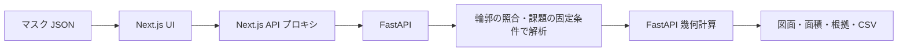

# 応募要件に対応した技術構成

## 実装と対応関係

| 応募要件 | 今回の実装 | 主な確認箇所 |
|---|---|---|
| Next.js フロントエンド | Next.js 16 App Router、React 19、TypeScript、SSR とクライアント側の図面操作、実行時 API プロキシ | frontend/src/app/, components/ |
| FastAPI バックエンド | JSON 解析、Pydantic 検証、型付きレスポンス | backend/app/main.py, schemas.py |
| コンテナ・IaC・CI/CD・クラウド | Next.js/FastAPI の Dockerfile、Compose、AWS ECS Fargate/ALB/ECR/IAM/CloudWatch の Terraform、GitHub Actions | compose.yaml, infra/, ワークスペース直下 .github/workflows/ |

単に技術名を並べるのではなく、マスク JSON の入力から面積計算・クラウド配置までに使う構成です。面積計算は再現可能な幾何計算として分離しています。



## 環境設定と起動

現在、必須の環境変数はありません。許可オリジン（`CORS_ORIGINS`）やアップロード上限（`MAX_UPLOAD_BYTES`）を上書きしたい場合だけ、`config/env.example` を `.env` にコピーして設定します。

Docker の場合:

```bash
cp config/env.example .env
# 必要な場合だけ .env を編集（Git に登録しない）
docker compose up --build
```

ローカル FastAPI の場合はアプリ直下から:

```bash
cd backend
.venv/bin/python -m pip install -r requirements-dev.txt
.venv/bin/uvicorn app.main:app --reload --port 8000 --env-file ../.env
```

別ターミナルでアプリ直下から `cd frontend && npm ci && npm run dev`。画面は http://localhost:5173、Compose は http://localhost:3000。

## 配置と開発フロー

Docker は非 root ユーザーで起動します。Next.js は standalone ビルドで配布し、実行時の `API_PROXY_TARGET` によりバックエンドを切り替えます。Compose はブラウザ向けの 3000 ポートだけをホストの loopback に公開します。

AWS は ALB の HTTPS → Fargate 内の Next.js → 同じタスク内の FastAPI という構成です。初回配置、DNS、証明書、GitHub OIDC 設定とロールバックは [インフラ手順](../infra/deployment.md) を参照してください。

GitHub に登録するルートは、`.github/` と `floorplan-analyzer/` が並ぶワークスペース直下を想定しています。アプリフォルダだけをリポジトリのルートにする場合は、workflow の配置とパスを変更する必要があります。

## 検証状況（2026-09-14 実施、2026-09-18 更新）

| 確認項目 | 結果 |
|---|---|
| バックエンド | pytest 全件成功（幾何計算・解析 API・キャッシュ・空間検索・変更前後の結果一致）。既存サンプルの計算値を維持 |
| フロントエンド | Vitest 全件成功。固定条件での解析、CSV の警告、API プロキシ、使い方ページ、アップロード欄、部屋表・図面の表示と拡大移動、部屋選択の表示速度を検証 |
| Next.js | 型検査・本番ビルド成功。standalone の SSR・静的 JS・サンプル・API 中継を HTTP で確認 |
| ブラウザ | Chrome でサンプル読み込み、11 部屋・床 48.75 m²・壁 155.54 m² 表示を確認。コンソールエラーなし |
| モバイル | 担当エージェントより 375×812 で初期画面・サンプル結果の横はみ出しなし、計算結果を確認したとの報告あり |
| Terraform | bootstrap/app 両構成の fmt・init -backend=false・validate 成功。AWS アカウントでの plan/apply は未実施 |
| GitHub Actions | workflow の actionlint 成功。GitHub 上での実行は未実施 |
| Docker | Dockerfile/Compose 作成済み。この環境には Docker がなく、コンテナの実ビルド・起動は未実施 |
| Vercel 公開 | READY。公開ページ・静的配信・FastAPI のサンプル解析が成功。[記録](vercel-deployment.md) |
| AWS 公開 | 認証情報・証明書・ドメイン・リポジトリ設定が未提供のため未実施 |

応募時には「実装済み」と「クラウドで稼働確認済み」を区別してください。過去の `docs/validation/REPORT.md` は人手で作成した輪郭に対する計算検証です。

上記ブラウザ検証の後、ユーザーから computer use 禁止の指定があり、以後の UI 自動操作を停止しています。以後の確認はコード・CLI・HTTP API・コンポーネントテストで行います。

公式仕様: [Next.js の配置](https://nextjs.org/docs/app/getting-started/deploying)。AWS・Terraform・GitHub の出典はインフラ手順に記載。

## 幾何計算の拡張（2026-09-14）

穴・重複の演算にShapely/GEOSを追加。扉開口で切れた壁は両側の壁と扉端が対応する場合だけ補完します。API契約・制限・人工データの検証値は [領域の拡張](geometry-upgrade.md) を参照してください。この拡張を入れた時点の検証はbackend86件、frontend22件、本番ビルド成功でした。2026-09-20 時点では backend 201件、frontend 48件です。過去のテスト数はその時点の記録です。
