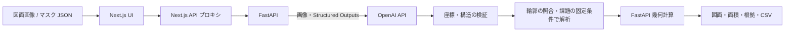

# 応募要件に対応した技術構成

## 実装と対応関係

| 応募要件 | 今回の実装 | 主な確認箇所 |
|---|---|---|
| 画像認識 AI / 生成 AI の組み込み | OpenAI Responses API の画像入力と Structured Outputs で部屋・壁・ドアの輪郭候補を作成。座標検証後、既存の幾何計算に接続 | backend/app/ai.py, ai_schemas.py, tests/test_ai.py |
| Next.js フロントエンド | Next.js 16 App Router、React 19、TypeScript、SSR とクライアント側の図面操作、実行時 API プロキシ | frontend/src/app/, components/AiImportPanel.tsx |
| FastAPI バックエンド | JSON 解析、画像アップロード、Pydantic 検証、非同期 AI 呼び出し、型付きレスポンス | backend/app/main.py, schemas.py |
| コンテナ・IaC・CI/CD・クラウド | Next.js/FastAPI の Dockerfile、Compose、AWS ECS Fargate/ALB/ECR/IAM/CloudWatch の Terraform、GitHub Actions | compose.yaml, infra/, ワークスペース直下 .github/workflows/ |

単に技術名を並べるのではなく、画像入力から面積計算・クラウド配置までに使う構成です。AI の役割は輪郭候補の抽出で、面積計算は再現可能な幾何計算として分離します。



## 画像 AI の処理

1. 利用者が PNG/JPEG、サイト利用トークン、OpenAI への送信確認を入力する。
2. FastAPI がトークンとファイルを検証する。最大 10 MB・1600 万画素・一辺 8192 px。EXIF の向きを補正し、モデルに送った画像と画面に表示する画像を一致させる。
3. モデルは画像の左上を (0,0)、右下を (1,1) とする座標で部屋の多角形、壁・ドアの線分、不確かな箇所を返す。図面中の文章は指示として扱わない。
4. Pydantic で座標範囲・有限数・頂点数・要素数・文字数を検証し、元画像のピクセル座標へ換算する。モデルの出力をコードとして実行しない。
5. 利用者が元画像と候補の重ね合わせを確認し、縮尺を入力する。縮尺は AI が確定しない。
6. 既存の床面積・壁面積計算を実行する。`ai_recognition` メタデータと `ai_generated` 警告により、AI 由来の参考値であることを画面と CSV に残す。

現時点の訂正方法は、候補 JSON を保存して座標を編集し、再読込する方式です。図面上の頂点ドラッグ編集や、自動縮尺推定は未実装です。

## AI 設定

`OPENAI_API_KEY`、`OPENAI_MODEL`、`AI_ACCESS_TOKEN` を **FastAPI サーバーの環境変数**に設定します。モデル ID は、使用するアカウントで画像入力と Structured Outputs が利用できるものを指定してください。未設定の場合、従来の JSON 解析は動作し、画像認識は 503 を返します。

`AI_ACCESS_TOKEN` はサイト利用者に渡す独立したランダム文字列です。OpenAI API キーを UI に入力・埋め込みしません。これは限定公開デモ向けの共通トークン方式で、ユーザー別ログイン・使用量管理は未実装です。

Docker の場合:

```bash
cp config/env.example .env
# .env に値を設定（Git に登録しない）
docker compose up --build
```

ローカル FastAPI の場合はアプリ直下から:

```bash
cd backend
.venv/bin/python -m pip install -r requirements-dev.txt
.venv/bin/uvicorn app.main:app --reload --port 8000 --env-file ../.env
```

別ターミナルでアプリ直下から `cd frontend && npm ci && npm run dev`。画面は http://localhost:5173、Compose は http://localhost:3000。

AI 呼び出しは `store: false`、自動再試行なし、時間上限付きです。これは OpenAI 側のすべてのデータ保持がなくなるという保証ではありません。送信確認の画面を設け、結果には認識の不確実性を表示します。

## 配置と開発フロー

Docker は非 root ユーザーで起動します。Next.js は standalone ビルドで配布し、実行時の `API_PROXY_TARGET` によりバックエンドを切り替えます。Compose はブラウザ向けの 3000 ポートだけをホストの loopback に公開します。

AWS は ALB の HTTPS → Fargate 内の Next.js → 同じタスク内の FastAPI という構成です。秘密値は既存の Secrets Manager から FastAPI に注入し、Terraform へは値ではなく ARN を渡します。初回配置、DNS、証明書、GitHub OIDC 設定とロールバックは [infra/README.md](../infra/README.md) を参照してください。

GitHub に登録するルートは、`.github/` と `floorplan-analyzer/` が並ぶワークスペース直下を想定しています。アプリフォルダだけをリポジトリのルートにする場合は、workflow の配置とパスを変更する必要があります。

## 検証状況（2026-09-14）

| 確認項目 | 結果 |
|---|---|
| バックエンド | pytest 66 件成功。AI 応答は HTTP モックで検証、既存サンプルの計算値を維持 |
| フロントエンド | Vitest 12 件成功。送信確認、認識確認、取消し、縮尺確認、CSV の警告、API プロキシを検証 |
| Next.js | 型検査・本番ビルド成功。standalone の SSR・静的 JS・サンプル・API 中継を HTTP で確認 |
| ブラウザ | Chrome でサンプル読み込み、11 部屋・床 48.75 m²・壁 155.54 m² 表示、AI 入力欄の表示と送信前の無効状態を確認。コンソールエラーなし |
| 画像の実ファイル選択 | Chrome 拡張の fileChooser.setFiles が Not allowed。ブラウザからの画像アップロード全工程は未確認（コンポーネント/API テストは成功） |
| モバイル | 担当エージェントより 375×812 で初期画面・AI 入力・サンプル結果の横はみ出しなし、送信無効・開閉・計算結果を確認したとの報告あり |
| Terraform | bootstrap/app 両構成の fmt・init -backend=false・validate 成功。AWS アカウントでの plan/apply は未実施 |
| GitHub Actions | workflow の actionlint 成功。GitHub 上での実行は未実施 |
| Docker | Dockerfile/Compose 作成済み。この環境には Docker がなく、コンテナの実ビルド・起動は未実施 |
| AI 実測精度 | 実 API は未呼び出し。新機能の部屋/壁/ドア検出精度は未測定 |
| Vercel 公開 | READY。公開ページ・静的配信・FastAPI のサンプル解析が成功。[記録](vercel-deployment.md) |
| AWS 公開 | 認証情報・証明書・ドメイン・リポジトリ設定が未提供のため未実施 |

応募時には「実装済み」と「クラウドで稼働確認済み」を区別してください。過去の `docs/validation/REPORT.md` は人手で作成した輪郭に対する計算検証で、新しい AI 認識の精度を示すものではありません。

上記ブラウザ検証の後、ユーザーから computer use 禁止の指定があり、以後の UI 自動操作を停止しています。以後の確認はコード・CLI・HTTP API・コンポーネントテストで行います。

公式仕様: [Next.js の配置](https://nextjs.org/docs/app/getting-started/deploying)、[OpenAI 画像入力](https://developers.openai.com/api/docs/guides/images-vision)、[Structured Outputs](https://developers.openai.com/api/docs/guides/structured-outputs)。AWS・Terraform・GitHub の出典はインフラ手順に記載。

## 幾何計算の拡張（2026-09-14）

穴・重複の演算にShapely/GEOSを追加。扉開口で切れた壁は両側の壁と扉端が対応する場合だけ補完します。API契約・制限・人工データの検証値は [領域の拡張](geometry-upgrade.md) を参照してください。最新検証はbackend86件、frontend22件、本番ビルド成功。過去のテスト数はその時点の記録です。
